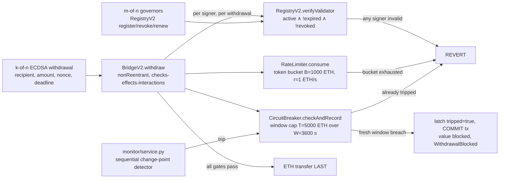

# BOLT: Bounded-Loss On-Chain Response for Cross-Chain Bridges


**BOLT is a bridge-security system**: a rate-limited, circuit-breaking exit path
that bounds worst-case attacker extraction on-chain, composed with a
**low-false-positive streaming detector** that tightens the response-latency term
of that bound. The motivating incident is the Ronin Bridge hack of March 2022:
173,600 ETH withdrawn through five compromised validator keys and detected six
days later. Under BOLT's locked parameters (B=1000 ETH, r=1 ETH/s, T=5000 ETH,
W=3600 s, D=480 s, 5-of-9 signing, 3-of-n governance) the same fast drain is
capped at `B + r·(W + Δ) = 4,660 ETH` (deterministic) and a patient drain at
`E[X_slow] ≤ B + r·D + r·Δ = 1,540 ETH` **in expectation** (at the synthetic
D=480 s; 2,468 ETH at the real Nomad-onset D=1,408 s; D = ARL₁ is a mean
detection delay, so the patient figure bounds mean, not per-run, extraction;
drift below the detector's detectability threshold is bounded only by the
limiter envelope `B + r·t`; see `docs/bolt/theorem.md` §14.2.1), both far below
the 173,600 ETH actually lost.
The architecture instantiates the Protect/Detect/Respond triad of the parent
MSc dissertation's MCF framework; everything from here on is a bridge-security
artifact.

This is a *design specification and proof of concept*, not a production
system. See `docs/evaluation.md` for the full results and limitations.

## Headline Results

| Claim | Result | Source |
|---|---|---|
| Bounded loss: fast drain | `X ≤ B + r·(W + Δ) = 4,660 ETH` (Δ = 60 s, W = 3,600 s) holds on every adversarial schedule, validated **on-chain in hardhat mode**; tightest margin +1,624 ETH. The superseded `T + r·Δ = 5,060 ETH` is a limiter-only reference level, not a bound | `docs/logs/scenario_5_bound.log`, `docs/bolt/theorem.md` |
| Bounded loss: patient drain | `E[X_slow] ≤ B + r·D + r·Δ = 1,540 ETH` **(expectation bound: D = ARL₁ is a mean delay; sub-detectability drift is limiter-envelope-only, `theorem.md` §14.2.1)**; 1,540 ETH is the synthetic D=480 s calibration, 2,468 ETH at the real Nomad-onset D=1,408 s; tightest margin +766.667 ETH (near-T-window, Δ = 300 s); non-vacuous ALT_TRIP config (T=4000 only) produces 5 genuine on-chain value trips | `docs/logs/scenario_5_bound.log` |
| Detection on **real** CCTX | Sequential detector AUC-ROC **0.9700** / AUC-PR 0.3740 on the honest **instantaneous** per-row statistic (the running-max artifact pair 0.9562/0.5381 is annotated, not headline); benign flag rate **φ = 0.0025** [0.0019, 0.0031] on 24,539 held-out real benign cross-chain rows, scored in the common USD denomination (de-circularized train-selected δ=0.25, λ=4, cap=2.0; all baselines FPR-matched to the same 1% budget; 1000-resample bootstrap CIs) | `docs/logs/scenario_6_detection_eval.log`, `docs/bolt/detection_eval.md` |
| Cost-to-evade | The genuinely adaptive attacker (grid + greedy refinement) evading detection (< 50% best det. prob.) at Ronin scale is forced to 174 tx over 87,581 s (~1 day); extraction rate collapses ~503× to 1.987 ETH/s; ≥ 116 sequential detect-and-halt cycles, ≤ 1,506 ETH per detection interval. Halt regimes attributed separately: MEASURED (no trip at the selected λ → limiter floor 3,531 ETH alt-trip / 88,581 ETH locked) vs MODEL-BASED assumed-D (1,506 ETH at D=480 s; 2,012 ETH at the real Nomad-onset D=1,408 s) | `docs/logs/scenario_7_cost_to_evade.log` |
| Benign utility of the bound | Replaying all 82,685 real benign transfers ($4.35B) through the locked limiter+breaker denies-or-delays **50.48% of benign value** (92 whale transfers > B carry 48.4%; delays negligible: P99 = 0 s, max 35 min; 0 benign halts). The 2.7%-of-Ronin envelope is a policy choice about the whale tail; the Pareto frontier (re-derived against the envelope, `docs/logs/j15_envelope_rederivation.log`) + scaling rule quantify the trade | `docs/logs/scenario_8_benign_utility.log`, `docs/bolt/benign_utility.md` |
| End-to-end Ronin replay | Composite score **1067.695** (CRITICAL, threshold 6.0); emit → `bridge.pause()` mined in **36.18 ms** wall-clock, Δ = 1 block | `docs/logs/scenario_2.log` |
| Mainnet-fork deployment | Fork block 25,482,769; composed response latency `Δ = δ_detect + δ_include ≈ 60 s` (≤ 6 blocks) vs the ≈ 43,200-block Ronin lag | `docs/bolt/deployment.md`, `docs/logs/deployment_fork.log` |
| Credential lifecycle | TTL expiry **and** revocation deny access at the Protect gate; revoked keys cannot be renewed in v2 | `docs/logs/scenario_1.log` |
| Gas cost | `withdraw` (k=5) avg 323,090 gas; `checkAndRecord` avg 282,091, constant in traffic volume | `docs/bolt/gas_report.md` |

**Detector claim (reframed; governs all detector statements in this repo):**

> The sequential detector is a **low-false-positive streaming complement** that reduces
> response latency and catches structuring/low-and-slow drains that value thresholds miss;
> the loss guarantee is carried by the on-chain limiter/breaker, with the detector
> tightening the δ_detect term of Δ (and hence the `r·Δ` slack in `X ≤ T + r·Δ` and the
> `r·D` term in the expectation bound `E[X_slow] ≤ B + r·D + r·Δ`).

No per-row classification-superiority claim is made: on pooled real-CCTX test rows
(scored in the common USD denomination, instantaneous per-row statistic) the
sequential detector's AUC is statistically above the FPR-matched value z-score
(+0.0984, p = 3.5e-62), robust-MAD and corrected-IsolationForest baselines, and
**below** only the labels-by-construction xchainwatcher-rules comparator (whose
recall 1.0 is circular: the incident labels are its own unmatched-withdrawal
output), reported in `docs/bolt/detection_eval.md`, including the
Tier-B deltas (φ doubled to 0.0025 under the de-circularized selection; AUC-PR
fell to 0.374 under the honest statistic). Its contribution is the ~22× lower
benign flag rate (φ = 0.0025) that makes automatic on-chain pausing affordable,
plus per-counterparty accumulation against low-and-slow drains (σ-sweep
crossover at 3.0 log-σ; the value baseline is blind below it).

All numbers are deterministic given `seed=42` and the locked ledger parameters;
the journal-grade evidence chain lives under `docs/bolt/` and `docs/logs/`.

## Architecture



Components:

| Component | File | Purpose |
|---|---|---|
| DID Registry v2 | `contracts/RegistryV2.sol` | m-of-n governed `did:ethr` credential lifecycle (`computeOpId`/`approve`/`executeRegister`/`executeRevoke`/`executeRenew`); `verifyValidator = active ∧ !revoked ∧ now < expiresAt`; revoked keys cannot be renewed |
| Bridge v2 | `contracts/BridgeV2.sol` | Holds ETH; k-of-n ECDSA `withdraw(recipient, amount, nonce, deadline, sigs)` with per-signer registry checks, nonce replay protection, `nonReentrant` + interaction-last; emits `WithdrawalBlocked` |
| Rate Limiter | `contracts/RateLimiter.sol` | Token bucket `RateLimiter(B, r, consumer)`: B=1000 ETH burst, r=1 ETH/s refill; reverts on exhaustion (the rate term of the BOLT bound) |
| Circuit Breaker | `contracts/CircuitBreaker.sol` | Sliding-window cap T=5000 ETH over W=3600 s; two-phase value trip (fresh breach latches + commits, blocking the value); monitor `trip()` + owner `reset()` |
| Anomaly Monitor | `monitor/service.py` + `monitor/anomaly.py` + `monitor/sequential_detector.py` | Per-counterparty Page-Hinkley/CUSUM detector alongside the composite z-score (thresholds 3.0/6.0); trips the breaker out-of-band. Service-code defaults are δ=0.5, λ=8.0, cap=2.0; the **evaluation headline uses the train-selected δ=0.25, λ=4, cap=2.0** (`docs/bolt/detection_eval.md`, de-circularized train-only selection over a disjoint attack-geometry family) |
| v1 baseline (superseded, intentionally vulnerable) | `contracts/MCFValidatorRegistry.sol` + `contracts/MockBridge.sol` | "Before" artifact for the Ronin narrative: renew-after-revoke defect demonstrated in `registry.spec.ts`; never deploy |

> **v1 baseline notice (V2 task 0.2).** `MCFValidatorRegistry` + `MockBridge` are kept
> **intentionally vulnerable** as the "before" baseline for the Ronin narrative:
> `renewValidator` reactivates a revoked key under a single owner (demonstrated by the
> `VULNERABLE BY DESIGN` test in `test/contracts/registry.spec.ts`). The hardened
> system is `RegistryV2` + `BridgeV2` + `RateLimiter` + `CircuitBreaker`, where renewal
> of a revoked key reverts (`registryv2.spec.ts`). Never deploy the v1 pair.

Full diagram and component description in `docs/architecture.md`.

## Prerequisites

- Node.js ≥ 20 LTS: pinned via `package.json` `engines` and `.tool-versions`.
- Python ≥ 3.11 (requires-python in `pyproject.toml`); **tested on 3.14.5** (the `.venv` interpreter in this dev environment as of 2026-07-09). All uv.lock markers cover 3.11–3.14.
- `uv` for Python dependency management (`pip install uv`).

## Install

```bash
make install
```

## Reproduce

One command regenerates the full evidence chain:

```bash
make reproduce
```

This runs, in order: dependency install → CCTX data pipeline → all Hardhat
contract tests → detector evaluation on the real CCTX splits (scenario 6) →
on-chain bound validation (scenario 5, **hardhat mode**) → adaptive-adversary
cost-to-evade sweep (scenario 7) → benign-utility replay + Pareto frontier
(scenario 8) → figure regeneration (scenarios 2 and 3).
The target starts and stops its own local Hardhat node and **fails hard**
(`make check-bound-log`) if the committed hardhat-mode bound log would ever be
replaced by a fallback simulation. Version pinning: `uv.lock` (Python) and
`package-lock.json` (Node); solc 0.8.24 pinned in `hardhat.config.ts`.

Prerequisites: Node ≥20, npm ≥10, Python ≥3.11 via `uv`; that is all
`make reproduce` needs. The broader `make all` additionally runs the Foundry
invariant suite (`make invariants`) and requires `forge` on `PATH`
(install via `foundryup`; see `docs/bolt/reproducibility.md` §1).

## Data availability

The CCTX splits derive from the public XChainWatcher dataset (arXiv:2410.02029; Ronin + Nomad incidents).
SHA-256: `data/cctx/train.parquet` = `2e509859f00235796ef890f30ede1e4b405937303ed02e1e274e33bd9e380f86`,
`data/cctx/test.parquet` = `079e4c4d5b510e260d0f95128ad7883c7860141a764701617a6baf2fd47cd0d0`.
Verify: `make data` then `cd data/cctx && sha256sum -c train.parquet.sha256 test.parquet.sha256`.
Full journal-facing statement and provenance: [`docs/bolt/data_availability.md`](docs/bolt/data_availability.md).

## Test

```bash
make install && make data && make test
```

`data/cctx/*.parquet` are gitignored (only SHA-256 sidecars are committed); `make test`
fails fast with an actionable message if they are absent. Run `make data` (or
`make data OFFLINE=1` for a synthetic fallback when offline) to build them before testing.
CI runs `make data` explicitly before `make test` (see `.github/workflows/ci.yml`).

Runs:

- **85 Hardhat contract tests** across 9 suites: `MCFValidatorRegistry` (v1 baseline, incl. the intentional `VULNERABLE BY DESIGN` renew-after-revoke demo), `MockBridge` (v1 baseline), `RegistryV2` (m-of-n lifecycle, revoked-cannot-renew, plus 8 `executeReinstate` tests added in the V2 reinstate phase), `BridgeV2` (k-of-n ECDSA, replay/deadline/zero-input rejection, per-signer registry checks, reentrancy), `RateLimiter` (token bucket), `CircuitBreaker` (window cap, two-phase trip, monitor trip, reset), `CircuitBreaker` gas-pin, `deploy_v2` deployment smoke tests, plus BridgeV2×CircuitBreaker integration (latch persistence through `withdraw`). **15 Foundry invariant/smoke tests** (10 stateful invariants + 5 smoke; `test/foundry/BridgeInvariants.t.sol`; run via `make invariants`). **Total: 220 tests** (85 Hardhat + 120 pytest + 15 Foundry).
- **120 pytest monitor tests**: sequential change-point detector (incl. the three ARL₁ censoring cases added
  with the `Arl1Estimate` return contract: full detection, fully censored, partially censored), detection-eval baselines + FPR-matching, train-only parameter selection (incl. the B2 geometry-disjointness asserts), CCTX generator, adaptive adversary (incl. greedy-refinement improve-or-equal/determinism), composite z-score + thresholds, service wiring, scenario-6 eval harness units, scenario-7 cost-to-evade harness, scenario-8 benign-utility simulator (contract-vector semantics, replay, determinism), IsolationForest comparator, synthetic baseline.
  (Reproducibility hardening later added 3 data-pipeline sidecar-verification
  tests, kept in `tests/data/test_fetch_sidecars.py` (outside `tests/monitor/`)
  so a live `pytest tests/monitor -q` collects exactly the 120 above.
  `make test` runs both directories; the 3 extra tests are infrastructure
  checks, not part of the 220 = 85 + 120 + 15 evaluation suite above.
  The monitor count was held at 117 through Phase 22 and moved to 120 when
  `measure_arl1` gained its censoring-aware return contract; the three added
  tests pin that behaviour and are not cosmetic additions to the total.)
- **Scenario scripts** (table below).

Exits 0 on success. Without a Hardhat node, scenario 2 falls back to a
scoring-kernel-only mode and the rest of the suite is chain-independent.
`bound-check` (scenario 5) in fallback-sim mode writes to
`docs/logs/scenario_5_bound.fallback.log` so the committed hardhat-mode evidence
in `docs/logs/scenario_5_bound.log` is never overwritten by a node-less run.

## Scenarios

| # | Script | What it proves | Live node? |
|---|---|---|---|
| 1 | `scenarios/scenario_1_lifecycle.py` | TTL expiry **and** revocation invalidate validator credentials at the Protect gate | required |
| 2 | `scenarios/scenario_2_ronin.py` | End-to-end dual-gate: 173,600 ETH submit → score 1067.695 CRITICAL → `bridge.pause()` mined within 1 block (36.18 ms) | optional (falls back) |
| 2b | `scenarios/scenario_2b_iforest_compare.py` | z-score vs sklearn IsolationForest agree on the headline case | no |
| 3 | `scenarios/scenario_3_stress.py` | Three composite-score stress probes: high-value / windowed-volume / structuring | no |
| 4 | `scenarios/scenario_4_fpr_sweep.py` | Synthetic FPR / power sweep over 7 buckets, 1,000 txs each | no |
| 5 | `scenarios/scenario_5_bound_validation.py` | On-chain validation of both loss bounds across adversarial schedules, incl. the non-vacuous ALT_TRIP config | required for hardhat mode (`make bound-check`) |
| 6 | `scenarios/scenario_6_detection_eval.py` | Real-CCTX detector evaluation: change-point-native metrics + ROC/PR/AUC, φ, ARL, σ sweep, DeLong/McNemar tests vs 4 FPR-matched comparators | no |
| 7 | `scenarios/scenario_7_cost_to_evade.py` | Adaptive-adversary (grid + greedy refinement) cost-to-evade sweep, λ empirical-trip sweep, halt-regime attribution + limiter/detector cost attribution | no |
| 8 | `scenarios/scenario_8_benign_utility.py` | Benign-utility replay of the full real CCTX stream through limiter+breaker: denial/delay/halt cost at locked params + bound-vs-utility Pareto frontier | no |

End-to-end scenarios with a live node:

```bash
npx hardhat node          # in another terminal
make scenario-1           # CREDENTIAL EXPIRED + CREDENTIAL REVOKED
make scenario-2-e2e       # bridge.paused() = True, ≈36 ms wall-clock
```

## Directory Structure

```
contracts/          RegistryV2.sol, BridgeV2.sol, RateLimiter.sol, CircuitBreaker.sol,
                    MCFValidatorRegistry.sol + MockBridge.sol (v1 baseline),
                    ReentrantAttacker.sol (test helper)
monitor/            anomaly.py, baseline.py, baselines.py, service.py,
                    sequential_detector.py, generator.py, adversary.py,
                    isolation_forest.py
scenarios/          scenario_1..4 (+ scenario_2b), scenario_5_bound_validation.py,
                    scenario_6_detection_eval.py (+ scenario_6b_elliptic_aux.py),
                    scenario_7_cost_to_evade.py, scenario_8_benign_utility.py
test/contracts/     registry.spec.ts, bridge.spec.ts, registryv2.spec.ts,
                    bridgev2.spec.ts, ratelimiter.spec.ts, circuitbreaker.spec.ts,
                    bridgev2_breaker_integration.spec.ts
tests/monitor/      pytest unit tests
data/cctx/          XChainWatcher-derived CCTX parquet splits (+ sha256 manifests)
figures/            scenario_2_timeline.png, stress_test_scores.png,
                    roc_pr_curves.png, arl_curves.png, lowslow_sweep.png,
                    bound_validation.png, cost_to_evade.png,
                    cost_attribution.png, benign_utility_pareto.png
docs/
  evaluation.md     Empirical results, residual limitations, traceability table
  architecture.md   Mermaid system diagram (v2 stack)
  bolt/             theorem.md, hypothesis.md, threat_model.md, detection_eval.md,
                    benign_utility.md, limitations.md, static_analysis.md,
                    reproducibility.md, related_work.md, h1_scorecard.md,
                    data_availability.md, ablations.md, deployment.md,
                    gas_report.md, coverage_report.md, slither_report.md
  parameter_choices.md   Justification for every numeric default
  INFO_PACK.md      Consolidated requirements the implementation traces to
  logs/             scenario_1..8 + deployment_fork captured output
```

## Reproducibility

- `make reproduce` is the one-command evidence regenerator (see above).
- All randomness seeded (`numpy.random.default_rng(seed=42)` in
  `monitor/baseline.py`; seeded splits in the CCTX pipeline).
- Hardhat Network is local-only, deterministic, resets between runs.
- No testnets, no paid services, no external IPFS or RPC dependencies.
- `.tool-versions` + `package.json` `engines` pin Node 20. Python requires ≥ 3.11;
  development and CI run on **3.14.5** (see `pyproject.toml`). All uv.lock markers
  cover 3.11–3.14 so any 3.11+ interpreter reproduces correctly.

Re-running the suite on a clean machine reproduces every score,
classification, and detection latency in `docs/evaluation.md` to within
sub-millisecond timing noise.

## Residual Limitations (What Is *Not* Claimed)

- **Synthetic-controlled portions remain.** The bound-validation schedules and
  the H1 canonical low-and-slow drain are injected (the H1 result is
  ILLUSTRATIVE-labelled); real-traffic evidence is the 24,539-row benign CCTX
  test split and the Ronin/Nomad incident rows.
- **Single-chain bound.** The loss bound covers one instrumented bridge exit on
  one chain; multi-bridge or cross-chain composition is not proven.
- **Monitor liveness assumed.** The patient bound's `r·D` term requires an
  operating monitor; with the monitor down, protection degrades to the on-chain
  limiter/breaker reference level (`T + r·Δ`, superseded as a bound by the envelope
  `B + r·(W + Δ)`).
- **Per-row Nomad recall is low.** Per-incident Nomad recall is 0.163 (vs the
  value z-score's 0.029 under no-future-information holdout calibration): the
  detector's catch is event-level accumulation, not per-row coverage. (The
  earlier "sub-ETH dust cohort, recall 0.000" limitation was a
  mixed-token-decimals artifact; in the common USD denomination the dust
  cohort is empty; see `docs/bolt/detection_eval.md` §5C.)
- **Label provenance / comparator caveat.** The incident labels are
  XChainWatcher's own unmatched-withdrawal output (one tool's reconstruction,
  not independent ground truth), so xchainwatcher-rules recall ≈ 1.0 is
  labels-by-construction. Mislabeling can run both ways: a benign transfer
  whose deposit failed to reconstruct becomes a false positive label; matched
  laundering becomes a false negative label
  (`docs/bolt/detection_eval.md` §Threats to validity).
- **Benign-utility cost is real.** The locked bound denies-or-delays 50.48% of
  benign *value* (whale-tail denial, not latency); the cost is quantified in
  `docs/bolt/benign_utility.md`.
- **Incident-level evidence is n = 2** (Ronin, Nomad).
- **Simplified governance.** m-of-n approvals on `RegistryV2`, not a
  production-grade multisig under live key-compromise scenarios.

These are residual limitations of an otherwise-evidenced design, scoped per the
dissertation's framing (§11.2.4, INFO_PACK §10) and `docs/bolt/threat_model.md`.

## Citation

Machine-readable metadata: `CITATION.cff` and `.zenodo.json` at the repo root.

**Data availability / DOI: to be minted.** Mint the DOI from the final commit,
then replace this line with the badge and fill the `doi:` field in `CITATION.cff`
and the `related_identifiers` entry in `.zenodo.json`. `docs/bolt/data_availability.md`
carries the dataset provenance statement in Springer format.

```bibtex
@misc{bolt_mcf_poc_2026,
  author       = {Hamza Allimia},
  title        = {{BOLT: Bounded-Loss Cross-Chain Bridge Exits with a
                  Formally Composed Detect-and-Halt Latency Term
                  (MCF Technical Proof of Concept)}},
  year         = {2026},
  howpublished = {MSc dissertation Chapter 11 technical artifact},
  note         = {[DOI: pending Zenodo deposit — see docs/bolt/reproducibility.md]}
}
```

## License

MIT. See the top-level `LICENSE` file and `contracts/*.sol` SPDX headers.
