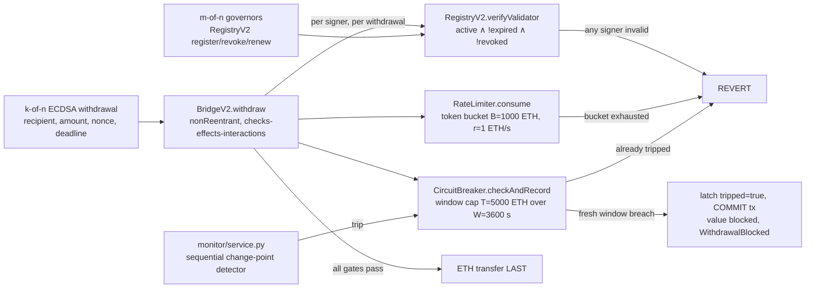

# MCF PoC Architecture

**Reference:** Dissertation Fig 11.1, §11.2.1, updated for the hardened v2 stack
(`RegistryV2` + `BridgeV2` + `RateLimiter` + `CircuitBreaker`). The original v1 pair
(`MCFValidatorRegistry` + `MockBridge`) is retained only as the intentionally
vulnerable "before" baseline (see [v1 baseline](#v1-baseline-superseded)).

## System Diagram

Every withdrawal must pass **all** on-chain gates in a single call path: k valid
validator signatures (each signer re-verified against the registry at withdrawal
time), an unexhausted token bucket (the rate term of the BOLT bound), and an
untripped sliding-window circuit breaker (the value-threshold term). The off-chain
monitor provides the detection term (δ_detect): it can trip the breaker out-of-band
via `CircuitBreaker.trip()`. A fresh window breach uses a **two-phase** semantics:
the tripping transaction latches `tripped = true` and COMMITS (the value is blocked
and `WithdrawalBlocked` is emitted, but the latch is not rolled back), so all
subsequent withdrawals are blocked until an owner `reset()`.

## Components

### `contracts/RegistryV2.sol`: m-of-n governed DID registry

- **Mechanism → contract → test:** governed credential lifecycle → `RegistryV2.sol`
  → `test/contracts/registryv2.spec.ts` (27 tests).
- m-of-n governor approval for every lifecycle mutation: `computeOpId` derives a
  deterministic operation id; governors `approve(opId)`; once the approval threshold
  is met, `executeRegister` / `executeRevoke` / `executeRenew` / `executeReinstate`
  proceed.
- `verifyValidator(addr) = active ∧ !revoked ∧ block.timestamp < expiresAt`: the
  strict `<` expiry boundary means a credential is invalid at the exact expiry second.
- **Revoked keys cannot be renewed:** `executeRenew` reverts with
  `"revoked: cannot renew"`; this closes the v1 Ronin failure mode where
  `renewValidator` silently reactivated a revoked key. A revoked key returns only
  via `executeReinstate`: a distinct m-of-n governed op that demands a fresh ECDSA
  key-control proof over a new credential document hash and a new ttl.
- DID format: `did:ethr:<chainId>:<validatorAddress>` (ERC-1056).

### `contracts/BridgeV2.sol`: k-of-n ECDSA withdrawal gate

- **Mechanism → contract → test:** signature-gated withdrawal path → `BridgeV2.sol`
  → `test/contracts/bridgev2.spec.ts` (14 tests) plus
  `test/contracts/bridgev2_breaker_integration.spec.ts` (1 test).
- `withdraw(recipient, amount, nonce, deadline, signatures)` verifies k-of-n ECDSA
  signatures over the digest `(recipient, amount, nonce, deadline, chainId,
  address(this))`; chain id and bridge address binding prevent cross-chain and
  cross-contract replay.
- Signer distinctness is enforced by requiring strictly increasing recovered signer
  addresses (no duplicate-signature threshold inflation).
- **Per-withdrawal registry check (G6):** every recovered signer is passed through
  `RegistryV2.verifyValidator` at withdrawal time; an expired or revoked validator
  invalidates its signature immediately, not at the next registry sync.
- Nonce replay protection (each nonce is single-use, marked used before the
  transfer), zero-recipient / zero-amount rejection, and expired-`deadline`
  rejection.
- Reentrancy defence: `nonReentrant` + checks-effects-interactions; the ETH
  transfer is the *last* operation, via `.call`.
- Emits `WithdrawalBlocked(recipient, amount, nonce, reason)` when the circuit
  breaker blocks a value-breaching withdrawal (two-phase commit path).

### `contracts/RateLimiter.sol`: token-bucket rate limit

- **Mechanism → contract → test:** outflow rate limiting → `RateLimiter.sol`
  → `test/contracts/ratelimiter.spec.ts` (7 tests).
- Constructor `RateLimiter(B, r, consumer)`: burst capacity **B = 1000 ETH**,
  refill rate **r = 1 ETH/s**; only the configured consumer (the bridge) may
  `consume`.
- Reverts on exhaustion (`"rate limit: bucket exhausted"` path in
  `BridgeV2.withdraw`), bounding the instantaneous outflow rate.
- This is the **rate term** of the BOLT loss bound (`docs/bolt/theorem.md`). The
  window parameters T/W are deliberately *not* duplicated here; `CircuitBreaker.sol`
  is their single source of truth (V2 task 0.4).

### `contracts/CircuitBreaker.sol`: sliding-window value breaker

- **Mechanism → contract → test:** window-cap value trip → `CircuitBreaker.sol`
  → `test/contracts/circuitbreaker.spec.ts` (8 tests) +
  `test/contracts/bridgev2_breaker_integration.spec.ts` (1 test, the
  through-`withdraw` latch-persistence proof).
- Sliding-window cap: trips when cumulative outflow within **W = 3600 s** would
  exceed **T = 5000 ETH**. Window records are timestamped and pruned once older
  than W (array-pruning implementation; see Scope Limitations).
- **Two-phase value trip (V2 task 0.1):** a fresh breach latches `tripped = true`
  and the transaction *commits*: the breaching value is blocked
  (`checkAndRecord` returns `true` (breached), the bridge emits `WithdrawalBlocked`), and
  because the latch is not reverted, every subsequent withdrawal is rejected until
  reset. An already-tripped breaker rejects immediately.
- **Monitor trip path (δ_detect):** the off-chain monitor address may call
  `trip()` directly; this is the detection term of the BOLT bound.
- Owner `reset()` re-arms the breaker (governance action, out of scope for the
  bound).

### Anomaly Monitor: `monitor/service.py` + `monitor/sequential_detector.py`

- **Mechanism → module → test:** sequential change-point detection →
  `monitor/sequential_detector.py` → `tests/monitor/test_sequential_detector.py`;
  service wiring (event subscription → score → `trip()`) → `monitor/service.py` →
  `tests/monitor/test_service.py`.
- Per-counterparty Page-Hinkley/CUSUM detector: sliding window **W = 3600 s**,
  drift **δ = 0.5**, trip threshold **λ = 8.0**, per-event contribution cap
  **2.0** (robustness against single heavy-tailed benign transactions).
- Runs alongside the composite z-score
  (`monitor/anomaly.py`: `0.5·value_z + 0.3·vol_z + 0.2·dest_novelty`, thresholds
  ALERT = 3.0 / CRITICAL = 6.0) used by the v1 demo pipeline.
- The real-CCTX evaluation (XChainWatcher data, ROC/PR/AUC/ARL vs three baselines)
  lives in `docs/bolt/detection_eval.md`.

### v1 baseline (superseded)

- `contracts/MCFValidatorRegistry.sol` + `contracts/MockBridge.sol` are the
  **intentionally vulnerable "before" artifact** for the Ronin narrative (V2 task
  0.2, decision (b)). **Never deploy the v1 pair.**
- The retained defect: `renewValidator` silently reactivates a REVOKED key under a
  single `Ownable` owner, demonstrated by the test
  `"VULNERABLE BY DESIGN: renewValidator silently reactivates a REVOKED key (Ronin
  failure mode; fixed in RegistryV2)"` in `test/contracts/registry.spec.ts`
  (10 tests); `test/contracts/bridge.spec.ts` (7 tests) covers the v1 bridge.
- The fix lives in `RegistryV2.executeRenew` (`"revoked: cannot renew"`).

## Data Flow Summary

1. Validators sign the withdrawal digest `(recipient, amount, nonce, deadline,
   chainId, bridge)` off-chain; a relayer submits `BridgeV2.withdraw` with k
   signatures.
2. The bridge recovers each signer (strictly increasing order), and calls
   `RegistryV2.verifyValidator` for every one; any inactive, expired, or revoked
   signer reverts the withdrawal.
3. The bridge calls `RateLimiter.consume(amount)` (reverts if the token bucket is
   exhausted) and `CircuitBreaker.checkAndRecord(amount)` (rejects if tripped;
   latches-and-commits on a fresh window breach, emitting `WithdrawalBlocked`).
4. Only after all gates pass is the ETH transferred (interaction last, under
   `nonReentrant`). Out-of-band, `monitor/service.py` scores the event stream and
   trips the breaker via `CircuitBreaker.trip()` on a change-point detection.

## Scope Limitations vs. Production

| Aspect | PoC | Production |
|--------|-----|------------|
| Governance | m-of-n `RegistryV2` governors, **immutable governor set** (hardening/scoping is V2 1.5, phase 19) | Gnosis Safe / rotatable threshold-sig governance |
| Breaker window | Array-pruning sliding window (O(records) prune per call; O(1) ring buffer is V2 1.7) | Constant-gas ring-buffer accounting |
| DID resolution | On-chain registry only | + off-chain `did:ethr` resolver |
| Baseline | Synthetic (seed=42) for the demo pipeline; real CCTX in `docs/bolt/detection_eval.md` | Live transaction history |
| Mempool feed | None | Real-time validator-set monitor |
| End-to-end latency | Local Hardhat single-tx path only | Network + RPC + signature aggregation |

