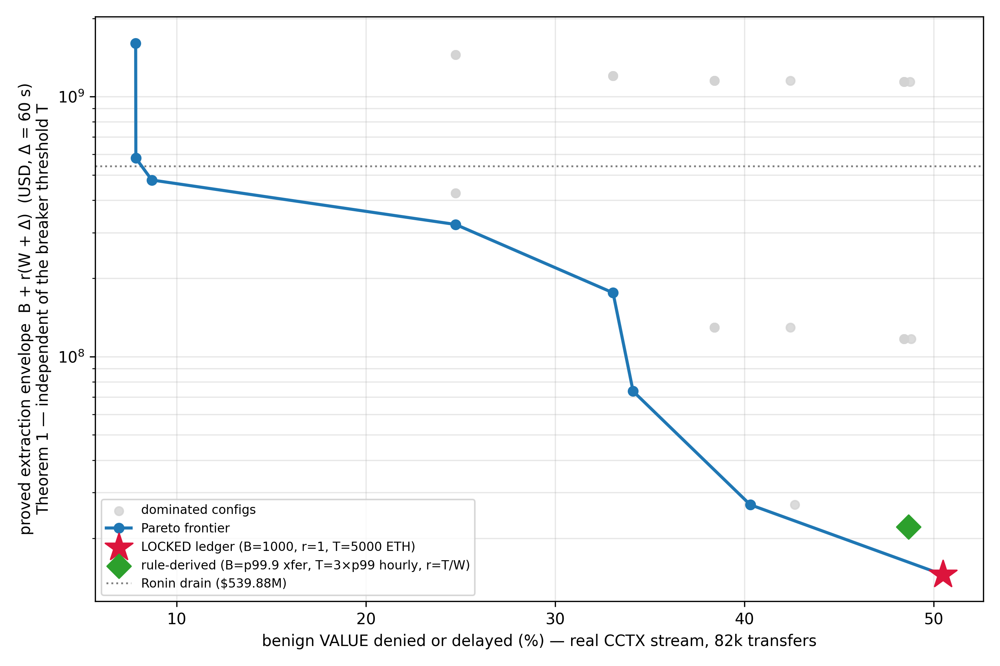

# Benign utility vs the extraction bound: the Pareto trade-off (Phase 22, B1)

> **J15/J16 SUPERSESSION NOTE (Wave 4, 2026-08-02).** The ordinate of this sweep was
> `T + r·Δ`, a form **refuted** as an upper bound (`docs/bolt/theorem.md` §14.1,
> `main.tex` Appendix A). The proved statement is the arrival-curve envelope
> `X ≤ B + r·(t_trip + Δ) ≤ B + r·(W + Δ)`, in which the breaker threshold `T` does
> not appear. The frontier has been **re-derived** against it:
> `docs/logs/j15_envelope_rederivation.log`, generated by
> `scenarios/rederive_j15_frontier.py`. Headline changes: the locked ledger's bound is
> **$14.49M = 2.7%** of the Ronin drain, not $15.74M = 2.9%; the 42 configurations
> collapse onto **15 distinct ordinates**; the frontier is **18 configurations at 8
> distinct locations**; and the claim that *no* configuration achieves both a
> sub-Ronin bound and single-digit benign denial **does not survive**: B=150,000,
> r=1 reaches an envelope of $477.9M (88.5% of Ronin) at 8.68% denied-or-delayed, all
> of it delay, with a p99 wait of 23,787 s. It bounds almost nothing, so the substance
> of the conclusion stands, but the literal claim had to be restated. The tables below
> are the ORIGINAL `T + r·Δ` numbers, retained for continuity; read the J15 log for
> the current frontier.

**Harness:** `scenarios/scenario_8_benign_utility.py` (`make benign-utility`; in the
`reproduce` chain). **Log:** `docs/logs/scenario_8_benign_utility.log`.
**Figure:** `figures/benign_utility_pareto.png`.
**Tests:** `tests/monitor/test_scenario_8.py` (18 tests: simulator core pinned to
contract semantics + replay semantics + smoke with all paths redirected).

This experiment answers the referee objection the earlier chapters left open: *"the
extraction bound is small because the bridge is throttled; no bound-vs-utility
trade-off is shown."* We replay the **full real benign CCTX stream** (XChainWatcher,
82,685 benign transfers, Jan–Dec 2022, $4.35B total value) through faithful offline
Python models of the deployed `RateLimiter` (token bucket `B`, `r`) and
`CircuitBreaker` (61-slot bucketed sliding window `W`, threshold `T`,
latch-until-reset, commit-not-revert with the bucket debited on a blocked breach,
which mirrors `BridgeV2.withdraw`'s consume-then-check order), and measure what the
locked parameters cost legitimate users. The run is deterministic and node-less.

## Method

1. **Replay.** Benign transfers are replayed in timestamp order at their real
   arrival times (integer Unix seconds, matching the contracts' integer
   arithmetic). A transfer the limiter cannot yet cover **retries until the bucket
   refills** (FIFO behind earlier waiting transfers: the bucket is a shared
   resource; FIFO is the simple deterministic contention model, conservative for
   aggregate delay). `delay = service − arrival`.
2. **Denial.** A transfer larger than `B` can *never* be admitted (the bucket clamps
   at `B`; `consume` reverts atomically) → counted as **denied**. A transfer larger
   than `T` breaches even an empty window → denied at the breaker (guard only; the
   swept grid keeps `T ≥ B`).
3. **Halts.** Cumulative benign traffic pushing a window over `T` latches the
   breaker: one benign-triggered **halt**; every transfer arriving while latched
   waits. **Reset assumption:** governance resets a benign latch after
   `RESET_DELAY = 3600 s` (= `W`): an optimistic operational response; the
   contract's `reset()` clears both the latch and the window.
4. **Pareto sweep.** A 42-config grid over `B ∈ {1k, 5k, 20k, 100k, 150k} ETH`,
   `r ∈ {1, 10, 100} ETH/s`, `T ∈ {5k, 20k, 100k, 200k} ETH` with `T ≥ B`,
   `W = 3600 s` fixed. x = fraction of benign **value** denied-or-delayed;
   y = **originally** the fast-regime level `T + r·Δ` at Δ = 60 s (composed latency,
   `docs/bolt/deployment.md`); **now** the proved envelope `B + r·(W + Δ)`; see the
   J15 note above and `docs/logs/j15_envelope_rederivation.log`.

## Denomination assumption (stated, with sensitivity)

The ledger is specified in ETH (`theorem.md`: B=1000 ETH, r=1 ETH/s, T=5000 ETH);
post-A1 the CCTX data is scored in the upstream common-denomination `value_usd`
column (raw `value` is token base units with mixed decimals, not comparable). We
scale the ledger to USD at **$3,110/ETH, the dataset's own valuation of the main
Ronin drain row** ($539,884,300 / 173,600 ETH), consistent with the 2022-03-23
market price (CoinGecko daily close ≈ $3.0–3.1k). Using the dataset-internal rate
puts the drain and the ledger on the same scale by construction.

Sensitivity (locked params): at $2,500/ETH the denied-or-delayed value share is
**53.68%**; at $3,110 it is **50.48%**; at $3,500 it is **49.34%**. The qualitative
result is insensitive to the price choice because the dominant cost comes from
benign whales 100×+ above `B`. (Replaying only ETH-native rows in ETH is not
implementable from the canonical schema, which has no token column, so the price
sweep is the robustness check.)

## Locked-params results (honest headline)

At the locked ledger (B = 1,000 ETH ≈ $3.11M, r = 1 ETH/s, T = 5,000 ETH ≈ $15.55M,
W = 3,600 s), @ $3,110/ETH:

| Metric | Value |
|---|---|
| Benign transfers denied (> B, structurally inadmissible) | **92 / 82,685 (0.111% of count)** |
| Benign **value** denied | **$2.11B = 48.43%** of $4.35B |
| Benign value delayed (> 0 s) | $89.25M = 2.05% |
| **Benign value denied-or-delayed** | **50.48%** |
| Per-transfer delay (served) | P50 = 0 s, P95 = 0 s, P99 = 0 s, **max = 2,121 s (≈ 35 min)** |
| Benign-triggered breaker halts | **0** (structural: B + r·W = 4,600 < T = 5,000; the value trip is unreachable at locked params, cf. the C2 finding) |
| Largest transfer served with zero delay | $3.09M (instant-admission cap = B = $3.11M) |
| Extraction envelope B + r·(W + Δ) | **$14.49M = 2.7% of the Ronin drain ($539.88M)**, the proved bound |
| *(superseded)* level T + r·Δ | $15.74M = 2.9%: limiter-only reference, **not** a bound |

**The critique's prediction is confirmed:** the locked
ledger's 34×-below-Ronin bound is purchased by structurally denying the benign whale
tail. Only 92 transfers exceed B, but they carry **48% of all benign value**: the
largest single benign transfer in the dataset is **$396.1M, 127× the bucket
capacity** (and 73% of the Ronin drain itself). Delays, by contrast, are a
non-issue: 99% of served transfers wait 0 s and the worst waits 35 minutes. The
utility cost of this design is concentrated entirely in whale denial, not in
latency, and benign traffic alone never halts the bridge at locked params.

Under ALT_TRIP (T = 4,000 ETH, the non-vacuous trip config): denied-or-delayed
rises to 51.35%, and benign traffic alone latches the breaker **6 times** over the
11-month stream (each an operator-reset event; input to the B8 griefing analysis),
with max delay 6,506 s.

## Pareto frontier

Representative points (@ $3,110/ETH, Δ = 60 s; full 42-row table in the log).
**These are the superseded `T + r·Δ` ordinates**; the envelope-ranked table is in
`docs/logs/j15_envelope_rederivation.log`:

| B (ETH) | r (ETH/s) | T (ETH) | Bound (USD) | % of Ronin | Benign value denied-or-delayed | Halts |
|---|---|---|---|---|---|---|
| 1,000 | 1 | 5,000 | $15.74M | 2.9% | 50.48% | 0 |
| 5,000 | 1 | 5,000 | $15.74M | 2.9% | 42.65% | 18 |
| 20,000 | 10 | 20,000 | $64.07M | 11.9% | 33.05% | 0 |
| 100,000 | 1 | 100,000 | $311.19M | 57.6% | 24.73% | 0 |
| 150,000 | 10 | 200,000 | $623.87M | 115.6% | 7.84% | 0 |

Readings:

- **The frontier is steep and whale-quantised.** Denial drops in discrete jumps as
  `B` crosses successive whale sizes; getting below ~25% of benign value
  denied-or-delayed already requires a bound ≥ $311M (58% of Ronin), and admitting
  the largest whale pushes the bound past the Ronin drain itself.
- **The locked ledger is itself Pareto-dominated on these two axes:** B=5,000/T=5,000
  achieves the same $15.74M bound with 7.8 points less benign-value denial, but at
  the cost of **18 benign-triggered halts/year** (each a full-bridge stop until
  governance reset), because whales near T fill the window. On the three-axis view
  (denial, bound, halts) the locked choice of `B ≪ T` is what buys *zero* benign
  halts.
- **No config on the grid achieves both a sub-Ronin bound and single-digit benign
  denial.** That is a property of the stream, not of the mechanism: benign
  cross-chain value is whale-concentrated (see the value-coverage table below), so
  *any* in-path value cap faces the same frontier.

## Parameter-scaling rule (how a real bridge would choose B/r/T)

All anchors are percentiles of **observed benign traffic**; an operator recomputes
them from their own history; nothing is tuned on attack data:

- **B** = the single-transfer size quantile the operator commits to admitting
  burst-free. Count-quantiles are the wrong knob on a whale-dominated stream
  (B = p99.9 of size ≈ $3.45M still denies 48% of *value*); choose B from the
  **value-coverage table**:

  | Benign value admitted burst-free | Required B | Implied bound floor (T ≥ B, r = 1) |
  |---|---|---|
  | 50% | $2.74M (880 ETH) | $2.92M (0.5% of Ronin) |
  | 60% | $9.20M (2,957 ETH) | $9.38M (1.7%) |
  | 75% | $155.81M (50,098 ETH) | $155.99M (28.9%) |
  | 90% | $339.85M (109,278 ETH) | $340.04M (63.0%) |
  | 99% | $396.11M (127,366 ETH) | $396.30M (73.4%) |

- **T** = max(B, 3 × p99 hourly benign volume): the window cap sits a small
  multiple above the heaviest observed benign hour (p99 hourly = $6.11M here), so
  cumulative benign traffic cannot approach a value trip (zero benign halts by
  construction margin).
- **r** = T / W: a full threshold-T window is sustainable at steady state, so the
  refill rate never binds before the window cap does. (Mean benign volume is only
  $542k/hour ≈ $150/s, so r is never the binding constraint on this stream; B is.)

Applied to this stream with the modest q = 99.9% count-quantile, the rule yields
B ≈ 1,111 ETH, r ≈ 1.64 ETH/s, T ≈ 5,889 ETH → bound **$18.62M (3.4% of Ronin)**
with 48.66% of value denied-or-delayed and zero halts. That is, the locked ledger is,
to first order, what the rule produces; raising the admitted-value coverage walks
the operator up the frontier in the table above.

**The honest conclusion for the paper (§7.5):** the BOLT bound is not free. On real
benign traffic it is a *policy choice* about the whale tail: a bridge willing to
subject transfers above a few $M to an out-of-band path (multi-party review, staged
release: exactly what the denied 92 transfers/year would need) gets a 2.7%-of-Ronin
worst-case envelope with zero benign halts and no measurable latency for 99.9% of
transfers; a bridge that must admit $100M+ single transfers in-path cannot have a
*useful* sub-Ronin envelope from rate-limiting alone: the one swept configuration
that gets there technically lands at 88.5% of the Ronin loss with a p99 benign wait
of over six hours. The frontier quantifies every point
between; the detector (Phase 12/16) is what covers the regime the limiter leaves
open.

## Limitations

- **FIFO retry model:** the contracts have no queue; real users retry off-chain. FIFO
  is deterministic and conservative for aggregate delay but can over-state the delay
  of small transfers stuck behind a waiting whale (immaterial here: P99 delay is 0 s).
- **Single conversion rate:** one incident-era $/ETH for an 11-month stream (token
  prices moved); the $2,500–$3,500 sensitivity bounds the effect on the headline
  (49.3–53.7%).
- **Reset assumption:** benign-halt recovery assumes a 1-hour governance reset;
  slower governance scales the halt-induced delays linearly (affects ALT_TRIP and
  the B=5,000/T=5,000 grid point; locked params have zero halts regardless).
- **Utility is value-weighted throughput only:** no modelling of user attrition,
  fee revenue, or the out-of-band cost of handling denied whales.
