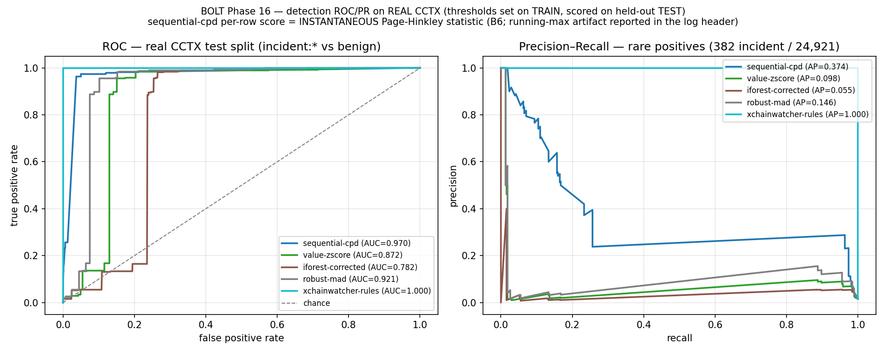
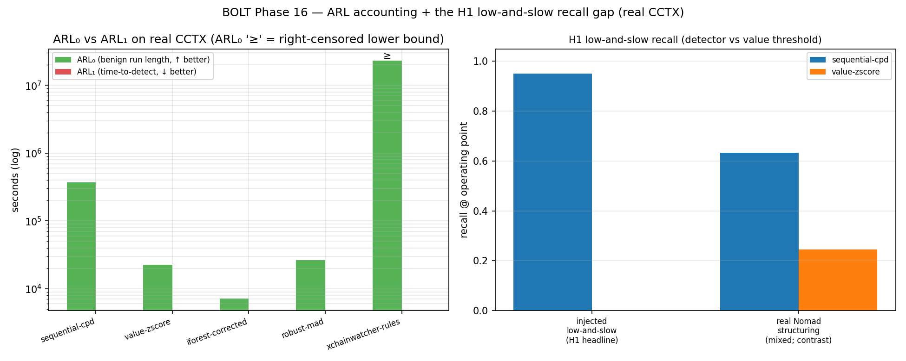
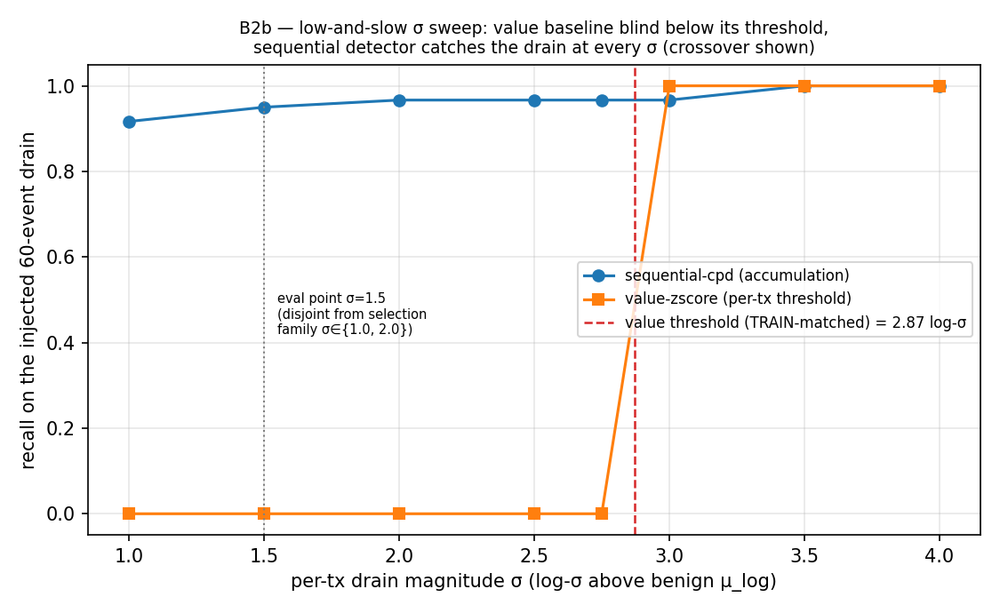
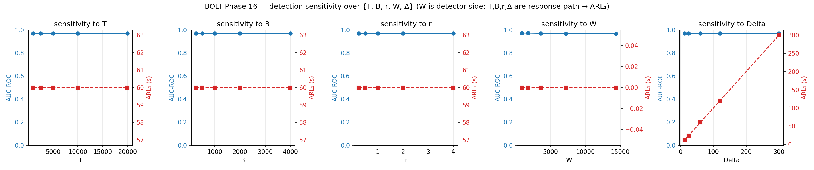

# BOLT: Detection Evaluation (contribution C1-eval)

> **BOLT** = *Bounded On-chain Loss Threshold*. This document is the non-circular
> detection evaluation for the **Detect** leg of [[hypothesis]] (H1). It is a
> **design specification, not a tested production system**: the absolute numbers
> below are illustrative of the design on one real dataset, not a guarantee that
> they transfer to a live bridge. Every false-positive figure carries a 95%
> confidence interval; the real-incident positive set is small (382 rows); the
> Elliptic auxiliary run is AML-not-bridge and was not run (see §8).

Related contract documents: [[hypothesis]] · [[theorem]] · [[threat_model]]

Source artefacts (do not re-derive; this document reports what the harness emitted):

- Harness: `scenarios/scenario_6_detection_eval.py`
- Run log: `docs/logs/scenario_6_detection_eval.log`
- Figures: `figures/roc_pr_curves.png`, `figures/arl_curves.png`,
  `figures/sensitivity.png`, `figures/lowslow_sweep.png`
- Reproduce: `make detector-eval` (node-less; pure Python/data; ~52 s)

> **SUPERSEDE NOTE (change-log: three revisions; do not cite older copies).**
>
> 1. **V2 task 2.3: train-only parameter selection.** The detector's δ/λ/cap are
>    no longer the hand-picked Phase-12 triple (0.5, 8.0, 2.0): they are selected
>    on the 100%-benign TRAIN split by `monitor/param_select.py`.
> 2. **Phase-22 task A1: per-token units fix.** The raw CCTX `value` column is
>    the on-chain amount in token **base units with mixed per-token decimals**
>    (18-dec ETH-class next to 6-dec USDC / 8-dec WBTC). Earlier runs divided
>    every value by 1e18, silently mis-scaling non-18-decimal rows (a ~$200
>    six-decimal stablecoin transfer read as ~2×10⁻⁷ "ETH"; Ronin's 25.5M-USDC
>    leg became value-invisible). All detectors now score the upstream
>    per-transaction **USD valuation** (`value_usd`), the one common
>    denomination; the loader asserts the Ronin drain row round-trips both ways
>    (1.736×10²³ base units = 173,600 ETH **and** value_usd = 539,884,276 USD).
> 3. **Phase-22 Tier B: evaluation overhaul (B2/B4/B5/B6).** Four methodology
>    fixes, each of which moved headline numbers:
>    (a) **B2: de-circularized selection.** δ/λ/cap are now selected by power
>    over a TRAIN-only attack-geometry family σ ∈ {1.0, 2.0} × events ∈ {30, 90}
>    that is disjoint **in both coordinates** from the σ=1.5/60-event evaluation
>    point (asserted in code). The selection picks **(δ=0.25, λ=4, cap=2.0)**
>    with φ_train = 0.00351, power_train = 0.922, replacing the earlier
>    (0.25, 4, 1.5) whose power was tuned on the identical geometry it was
>    scored on. Under the new triple the held-out **φ doubles (0.0013 → 0.0025)**.
>    The tautological all-True McNemar is demoted (§Test statistics).
>    (b) **B4: FPR-matched baselines.** Every baseline's flag threshold is now
>    calibrated on TRAIN benign to the **same 1% FPR budget** the sequential
>    selection uses; the old defaults (value fast-path q0.999, robust-MAD k=3.5,
>    IsolationForest `contamination="auto"`) are demoted to a labelled secondary
>    table. This **closes part of the gap**: the matched value baselines gain
>    recall (e.g. real-structuring per-tx 0.245, was 0.031 at the old default).
>    (c) **B5: real bootstrap.** All CIs are now a **1000-resample** stratified
>    two-sided bootstrap from one seeded RNG. The previous "12-seed" bands were
>    12 resamples of one deterministic output, never independent replicates,
>    and are retired.
>    (d) **B6: honest per-row score.** The per-row ROC/PR score is now the
>    **instantaneous** Page-Hinkley statistic. The previous headline used the
>    **running max**, which is monotone along the stream, so its AUC partly
>    ranked rows by *time order* rather than content. Under the honest statistic
>    **AUC-ROC rises (0.9562 → 0.9700) but AUC-PR falls substantially
>    (0.5381 → 0.3740)**; change-point-native
>    metrics (delay/ARL/precision at the matched budget) are primary.
>
> The current headline on the held-out TEST split is **AUC-ROC 0.9700, AUC-PR
> 0.3740 (instantaneous score), F1 0.2520, φ 0.0025** (run log
> `docs/logs/scenario_6_detection_eval.log`); the running-max artifact pair
> (AUC-ROC 0.9562 / AUC-PR 0.5381) is retained as an annotated artifact only.
> Superseded numbers (the pre-Tier-B AUC-ROC 0.9562 / AUC-PR 0.5381 / φ 0.0013
> headline under (0.25, 4, 1.5), the pre-units-fix AUC-ROC 0.8548 / AUC-PR
> 0.0518 / φ 0.0070, and the legacy-triple AUC-ROC 0.6513 / φ 0.00695) are
> retained in this note as history only and must not be cited. Two further
> pre-fix artifacts fell to the units fix: the "88% sub-ETH dust cohort" was a
> mixed-decimals artifact (§5C), and the positive count changed 384 → **382**
> (12 of the 83,079 raw rows carry no upstream USD valuation and are dropped at
> build time, 2 of them Nomad attack rows; the build prints the drop).
> Per-config deltas for the full 45-config grid, the composite-weight grid, and the
> ALERT-threshold axis are in `docs/bolt/ablations.md`; the composite weights
> (0.5, 0.3, 0.2) and ALERT=3.0/CRITICAL=6.0 remain dissertation-fixed (§11.2.3):
> ablated, never train-selected.

---

## 1. What this closes (and why the old number was not evidence)

The legacy MCF detection headline was **"0% false-positive rate"**. That figure
was **circular** (gap **G3**, a P0 gap): it was measured on draws from the *same*
Gaussian generator that had been used to *set* the detector thresholds. Scoring
the threshold-setting distribution can only ever reproduce the threshold; it is
not evidence about benign traffic the detector has never seen.

Phase 16 replaces it with a **real evaluation on real data with real baselines and
confidence intervals**:

- **Data:** the real **XChainWatcher CCTX** dataset (arXiv:2410.02029): 83,079
  cross-chain transfers in which the Ronin (173,600 ETH) and Nomad bridge drains
  are present and labelled. 12 rows (incl. 2 Nomad attack rows) carry no
  upstream USD valuation and are dropped at build time, leaving 83,067 usable
  rows and **382 incident positives** (380 Nomad + 2 Ronin). (Label provenance
  and its construct-validity limits: §Threats to validity below.)
- **Anti-circularity (the whole point):** every detector's thresholds /
  location-scale are calibrated on the **TRAIN** split (`data/cctx/train.parquet`,
  58,146 rows, **100% benign**). Every reported metric (ROC, PR, AUC, F1, φ, ARL)
  is measured on the **held-out TEST** split (`data/cctx/test.parquet`, 24,921
  rows = 24,539 benign + 382 incident). The splits are disjoint in time, so the
  threshold-setting data is **never scored**. This is doubly non-circular:
  (a) thresholds come from train, metrics from test; (b) the positives exist
  *only* in test, so calibration never sees a single attack row. Additionally
  (Phase-22 B2) the (δ, λ, cap) selection maximises power over a TRAIN-only
  attack-geometry family disjoint in both coordinates from the geometry the
  low-and-slow claim is evaluated at.
  `sha256` sidecars verified on both splits.
- **Baselines:** the H1 value-threshold baseline plus three fairly-tuned
  comparators (§3), all run through **one shared scoring interface** on one
  dataset with one seed set (no bespoke per-baseline ROC code) and **all
  FPR-matched on TRAIN to the same 1% benign budget** (Phase-22 B4).
- **Units (Phase-22 A1):** the raw CCTX `value` is the on-chain amount in token
  **base units with mixed per-token decimals** (not cross-token comparable),
  so all detectors score the per-transaction **USD valuation** (`value_usd`),
  the one common denomination. The loader **asserts** the Ronin drain row
  round-trips both ways (1.736×10²³ base units = 173,600 ETH and
  value_usd = 539,884,276 USD); a silent unit mismatch would destroy the ROC.
- **Scale:** bridge value is heavy-tailed across many orders of magnitude
  (sub-dollar transfers to a $396M benign whale). A raw mean/σ z-score is the
  wrong statistic (σ is dominated by a few whales, collapsing every z toward 0).
  All value detectors therefore score on a **signed log deviation**
  `z = (log10(value_usd) − μ_log)/σ_log` with `μ_log = 2.8902`,
  `σ_log = 1.0894` calibrated on TRAIN benign: the same scale for the
  detector's `value_z` feature and the value baselines, which keeps the
  comparison apples-to-apples.

This also closes gap **G10** in principle (Elliptic was cited-but-never-used); the
auxiliary Elliptic branch exists but did not run offline; see §8.

---

## 2. Comparison table: sequential detector vs ≥3 baselines (held-out real TEST)

### 2a. Primary: change-point-native metrics (Phase-22 B6)

A streaming change-point detector is judged by **when** it fires (delay after
onset, run length between false alarms) and **what its alarms are worth**
(precision at a fixed benign-FPR budget), not by per-row population AUC. Every
operating point below is calibrated on TRAIN to the **same 1% benign-FPR
budget** (B4); realized TEST φ can exceed the train budget under train→test
drift. The `xchainwatcher-rules` row is
labels-by-construction: read §Threats to validity before citing it.

| Detector | ARL₀ (s) | ARL₁ (s) | prec@op | φ (test) | train target |
|---|---|---|---|---|---|
| **sequential-cpd** (system under test) | **371,868** | 0 | **0.5079** | **0.0025** | ≤ 0.01 |
| value-zscore (the H1 baseline) | 22,648 | 0 | 0.0366 | 0.0548 | ≤ 0.01 |
| iforest-corrected | 7,129 | 0 | 0.0113 | 0.1819 | ≤ 0.01 |
| robust-mad | 26,350 | 0 | 0.0432 | 0.0460 | ≤ 0.01 |
| xchainwatcher-rules (labels-by-construction¹) | ≥ 23,055,842 | 0 | 1.0000 | 0.0000 | rule-based (n/a) |

¹ *B7 caveat: the incident labels are this comparator's own unmatched-withdrawal
output, so its recall/precision here are by construction, not measured
capability; see §Threats to validity.*

Per-destination detection delay (sequential detector, the distributional
primary delay statement; detail in §5): **detected 14/16** real Nomad
structuring destinations; mean finite delay **1,792 s**, bootstrap 95% CI
**[1,144, 2,536] s**; 2 destinations never detected.

Operating-point calibration provenance (B4): sequential-cpd (δ, λ, cap)
train-selected under φ_train ≤ 0.01 with fast-path z = TRAIN q0.999 = 3.414;
value-zscore |log-z| > 2.873 (TRAIN q0.99); iforest-corrected score > 0.6907
(TRAIN q0.99); robust-mad robust-z > k = 3.999 (TRAIN q0.99; the as-published
k = 3.5 is secondary).

### 2b. Secondary: per-row population metrics

All metrics on the held-out real CCTX TEST split (incident:* vs benign). The
sequential detector's per-row score is the **instantaneous** Page-Hinkley
statistic (B6); the legacy running-max scorer is quantified in the SUPERSEDE
NOTE (AUC-ROC 0.9562 / AUC-PR 0.5381) and retained as an annotated artifact
only. The **mean [95% CI]** columns come from a **1000-resample** stratified
**two-sided** bootstrap that resamples BOTH classes with replacement (§6). The
three ROC-axis baselines are **statistically distinct scorers** (mean/σ log-z,
robust median/MAD log-z, and the IsolationForest), not one statistic under
different thresholds; see §3.

| Detector | AUC-ROC [95% CI] | AUC-PR [95% CI] | F1 [95% CI] | φ benign-FP [95% CI] |
|---|---|---|---|---|
| **sequential-cpd** (system under test) | 0.9702 [0.9615, 0.9778] | 0.3749 [0.3410, 0.4101] | 0.2503 [0.2000, 0.3021] | **0.0025 [0.0019, 0.0031]** |
| value-zscore (the H1 baseline) | 0.8714 [0.8631, 0.8790] | 0.0978 [0.0856, 0.1118] | 0.0570 [0.0432, 0.0719] | 0.0548 [0.0520, 0.0576] |
| iforest-corrected | 0.7819 [0.7741, 0.7906] | 0.0552 [0.0490, 0.0650] | 0.0207 [0.0158, 0.0261] | 0.1819 [0.1771, 0.1869] |
| robust-mad | 0.9213 [0.9146, 0.9271] | 0.1461 [0.1331, 0.1609] | 0.0648 [0.0493, 0.0817] | 0.0461 [0.0435, 0.0486] |
| xchainwatcher-rules (labels-by-construction¹) | 1.0000 [1.0000, 1.0000] | 1.0000 [1.0000, 1.0000] | 1.0000 [1.0000, 1.0000] | 0.0000 [0.0000, 0.0000] |

Confusion at the calibrated operating point, `[[TN, FP], [FN, TP]]` (rows = truth,
cols = prediction; 24,539 benign / 382 incident):

| Detector | TN | FP | FN | TP |
|---|---|---|---|---|
| sequential-cpd | 24,477 | 62 | 318 | 64 |
| value-zscore | 23,195 | 1,344 | 331 | 51 |
| iforest-corrected | 20,076 | 4,463 | 331 | 51 |
| robust-mad | 23,409 | 1,130 | 331 | 51 |
| xchainwatcher-rules¹ | 24,539 | 0 | 0 | 382 |

¹ *labels-by-construction (B7): its 0 FN / 0 FP row restates the label pipeline,
not a measured capability; see §Threats to validity.*

**Reading guide (units and direction):**

- **ARL₀** = mean run length between *false* trips on benign TEST (seconds; higher
  is better). The sequential detector's ARL₀ = 371,868 s (~4.3 days between false
  trips; 62 benign FPs over the TEST window). `≥` denotes a **right-censored
  lower bound**: `xchainwatcher-rules` never false-trips on this dataset, so its
  ARL₀ is reported as ≥ the observed benign duration, exactly as Phase 12 reported.
  (Change-log honesty: under the previous circular selection the ARL₀ was
  743,737 s / 31 FPs; the de-circularized triple's φ is twice as high, and the
  availability consequence is propagated to `docs/bolt/threat_model.md` §B8.)
- **ARL₁** = mean time-to-detection (seconds) from the real Ronin incident onset
  on TEST (lower is better). The sequential detector's ARL₁ = 0 s because the
  Ronin drain row's signed-log-z exceeds the train-derived fast-path threshold
  (TRAIN q0.999 = 3.414), so the drain trips on its **own** event, a
  single-event catch identical to a value threshold, **not** a
  sequential-accumulation result; the assertion `ARL₁ < ARL₀` holds
  (0 < 371,868). The representative time-to-detection for the
  accumulating/low-and-slow regime is the **Nomad-onset ARL₁ = 1,408 s**.
  **Caveat (V2 2.6): that Nomad onset is a single onset (n ≈ 1)**; the
  per-destination delay bootstrap in §5 is the only distributional statement we
  can honestly make about time-to-detection on real data.
- **φ** = benign false-positive rate at the operating point (see §4).

**The honest finding, and why H1 needs a sequential detector.** The value
baselines attain respectable value-AUC, but even at FPR-matched operating
points they realize 18–73× the sequential detector's benign flag rate on test
(§4). This is not a tuning accident: in the common USD denomination, benign
whale transfers are of the same order as the largest drain rows (the largest
benign transfer is **$396M in train / $156M in test**; only the single biggest
Ronin leg, **$539.9M**, exceeds every benign transfer, while the second Ronin
leg, $25.5M, and all Nomad rows sit **inside the benign bulk**), so **no
per-transaction value threshold cleanly separates incidents from benign traffic
on value alone.** That is precisely the motivation for H1. The sequential
detector's contribution is therefore **not** the raw per-row AUC: a streaming
per-counterparty change-point detector is not a per-row population classifier,
and its per-row numbers are reported as *secondary* (with the note that
the instantaneous statistic's AUC-PR, 0.374, is well below the running-max
artifact's 0.538). Its headline strengths are the two H1 terms: **near-zero φ
on real benign traffic** (§4) and the **low-and-slow recall gap in the
sub-threshold band**: on the canonical injected drain (§5A; ILLUSTRATIVE,
synthetic schedule on real benign cadence) the value threshold has zero recall
below its own threshold, the σ sweep (§5A′) shows exactly where that blindness
ends (crossover σ = 3.0), and the same direction holds on the **real** Nomad
structuring cohort (§5B, cluster CIs: per-tx 0.633 vs 0.245, a real but
narrower gap now that the value baseline is budget-matched); the claim remains
*complement*, not per-row superiority.

---

## 3. The baselines (fairly tuned, no strawmen)

Four detectors run through the one shared `score(df) -> (scores, flags)` contract
in `monitor/baselines.py` / the harness, so ROC/PR/AUC are computed identically:

1. **value-zscore**: `monitor/anomaly.py` value-threshold baseline. Continuous
   score = the **mean/σ** `|signed log-z| = |log10(v) − μ_log|/σ_log`; binary flag
   at the TRAIN-matched 1%-budget threshold |log-z| > 2.873 (B4). This is the
   **"value-threshold baseline" H1 says low-and-slow exfiltration evades.**
2. **iforest-corrected**: `monitor.baselines.IsolationForestBaseline`. The
   §4.1e degeneracy is **fixed**: the original `_features` gave every training row
   `novelty = 0` (a zero-variance, all-zero column carrying no fit-time signal, so
   the forest learned only the value distribution and the novelty dimension was
   dead weight). The corrected baseline makes **destination-novelty non-constant in
   the training set** (both `novelty=0` and `novelty=1` rows present at fit time),
   so the forest actually learns it; a novel-destination tx now scores more
   anomalous than an identical-value known-destination tx. Fit on log-value +
   destination novelty; flag threshold = TRAIN score q0.99 (1% budget, B4);
   `contamination="auto"` demoted to the secondary defaults table.
3. **robust-mad**: `monitor.baselines.RobustMadBaseline`. A **robust** median /
   MAD outlier rule on log-value: continuous = the modified z
   `|log-value − median| / (1.4826·MAD)`, flag at the TRAIN-matched
   k = 3.999 (1% budget, B4; the Iglewicz–Hoaglin as-published k = 3.5 is
   secondary; the row was previously named `robust-mad-3.5`). This is the
   **third, statistically-distinct** ROC-axis scorer.

   > **Why median/MAD and not a rolling-mean/σ rule (disclosure of an avoided
   > duplicate; the specific numbers below were measured on the pre-units-fix
   > ETH-denominated draft and are kept as change-log history).** An earlier draft
   > used a `rolling-sigma-3` baseline whose continuous score was `|log-value − μ|/σ`
   > with μ, σ calibrated on log-train. That is **byte-identical** to the
   > value-zscore statistic (mean/σ of the same log-values): on the pre-fix draft,
   > correlation 1.0, max abs diff 2.7e-5, identical AUC-ROC/AUC-PR: the two
   > coincided on ROC/PR *by construction*, differing only in the binary flag
   > threshold. That is one statistic under two thresholds, not two distinct
   > baselines, so it did not honestly satisfy "≥3 baselines" on the ROC axis. We
   > therefore replace it with a genuinely different statistic: the **median and
   > MAD are robust to the heavy tail** (a few whale transfers inflate the mean/σ
   > but not the median/MAD), so the robust z gives a *different ranking* and a
   > *different* AUC-ROC (0.9214 vs the value z-score's 0.8716 on the current USD
   > run) . `RollingSigmaBaseline` remains in `monitor.baselines` (unit-tested)
   > but is intentionally **not** used as a distinct ROC-axis baseline;
   > `test_robust_mad_is_distinct_from_mean_sigma_zscore` guards against the third
   > baseline ever collapsing back onto the value z-score.
4. **value-zscore corroboration (qualitative).** The dissertation's *own* composite
   scorer `monitor.anomaly.compute_score` is invoked directly on the low-and-slow
   transaction (§5) to confirm the real repo baseline, not just the log-scaled
   comparator, scores it **NORMAL** (−0.578). This grounds the H1 claim in the
   actual baseline function shipped in the repo.

**Operating-point fairness (B4).** Every baseline's flag threshold is calibrated
on TRAIN benign to the **same 1% FPR budget** the sequential detector's
selection uses, so the operating-point comparison is budget-matched, not
default-vs-tuned. The old defaults are retained only as a labelled secondary
row set (same continuous scores, so the AUC columns are unchanged):

| Detector | default rule (secondary, NOT budget-matched) | φ (test) | F1 | prec@op |
|---|---|---|---|---|
| value-zscore | \|log-z\| > fast-path q0.999 (= 3.414) | 0.0251 | 0.0218 | 0.0175 |
| iforest-corrected | `contamination="auto"` predict | 0.8630 | 0.0348 | 0.0177 |
| robust-mad | robust-z > k = 3.5 (Iglewicz–Hoaglin) | 0.0619 | 0.0533 | 0.0331 |

The sequential detector winning against a deliberately-crippled baseline would
not be a result; these are not crippled (matched budgets, distinct statistics,
no padded duplicate).

---

## 4. φ: benign false-positive rate on REAL CCTX (the H1 term Phase 17 consumes)

**φ is measured on the held-out REAL benign CCTX TEST rows (24,539 benign), NOT on
the threshold-setting generator.** This is the anti-circular φ that closes G3 and
is the exact quantity [[hypothesis]] (H1) budgets and that Phase 17 consumes
downstream.

| Detector | φ (benign FP rate) | 95% CI |
|---|---|---|
| **sequential-cpd** | **0.00250** | **[0.00192, 0.00310]** |
| value-zscore | 0.05477 | [0.05196, 0.05758] |
| iforest-corrected | 0.18190 | [0.17706, 0.18693] |
| robust-mad | 0.04605 | [0.04352, 0.04862] |
| xchainwatcher-rules | 0.00000 | [0.00000, 0.00000] |

The sequential detector's **φ ≈ 0.25%** is ~22× lower than the budget-matched
value z-score (5.5%), ~18× lower than matched robust-MAD (4.6%), and ~73× lower
than the matched IsolationForest (18.2%). (`xchainwatcher-rules` reaches φ = 0,
but its labels are its own rule output; see §Threats to validity.) This
is achieved **while keeping the sub-threshold low-and-slow recall the value
threshold lacks** (§5): the H1 clause is "detects low-and-slow … *at a
false-positive cost of ≤ φ on benign bridge traffic*", and φ ≈ 0.0025 (with its
CI) is the value that clause is now instantiated with.

> Honest framing, two parts. (i) φ carries sampling uncertainty (the CI above)
> and is specific to this dataset and operating point; H1 does **not** assert φ
> a priori: it is the *measured* benign cost, and absolute false-positive rates
> on a live bridge remain unknown until measured there. (ii) **Train→test drift
> penalizes all detectors' budgets, worst for the value axis:** all four tuned
> detectors were calibrated to a 1% TRAIN budget, yet on TEST the value
> baselines realize 4.6–18.2% while the sequential detector realizes 0.25%.
> The 1% budget is honoured out-of-sample only by the sequential detector; the
> value-axis overshoot (worst: iforest at 0.1819 against a 0.01 budget) is a
> genuine distribution-shift finding, reported per row in the run log. Note
> also that the de-circularized selection **doubled** the sequential φ
> (0.0013 → 0.0025): the earlier lower φ was partly a product of tuning
> geometry the evaluation reused.

---

## 5. The low-and-slow complement (H1 clause under test)

H1 requires the sequential detector to **detect low-and-slow exfiltration that a
value-threshold baseline misses**. The evidence is presented in four parts:
one **labelled-illustrative** canonical case (A), a σ sweep that
shows exactly where the value baseline's blindness ends rather than a single
rigged point (A′; Phase-22 B2b), the real Nomad structuring cohort with
cluster-bootstrap CIs (B: the sequential detector wins this contrast, but at
matched budgets the gap is narrower than previously reported, and the cohort is
mixed structuring, not a pure low-and-slow drain), and the dust sub-cohort
re-derived in the corrected units (C: empty), plus the per-destination ARL₁
bootstrap behind the n≈1 onset caveat.

### A. Canonical injected drain (ILLUSTRATIVE: synthetic schedule on real benign cadence)

A same-counterparty drain is injected on the **real benign TEST inter-arrival
cadence** (sampled from real benign gaps), each withdrawal **$33,439.74 = 1.50
log-σ above benign**. The *schedule is synthetic*: this section is the
**illustrative** demonstration of the accumulation mechanism, not a real-data
recall claim. **Geometry disjointness (B2a):** the evaluation geometry
(σ = 1.5, 60 events) is a member of *neither* coordinate of the σ ∈ {1.0, 2.0}
× events ∈ {30, 90} family the detector parameters were selected on;
the params were never tuned to the exact attack they are scored against.

- per-tx signed-log-z = **1.50**, while the benign `|log-z|` 99th percentile =
  **4.293** → each individual transaction is **below** the benign p99, so the
  log-scaled value threshold **MISSES every transaction**.
- the real repo baseline `monitor.anomaly.compute_score` scores this tx
  **−0.5781 → NORMAL (MISSES)**, so the dissertation's own scorer corroborates the miss.
- the **sequential detector trips after 4 same-counterparty events** via
  per-counterparty accumulation.

**Recall at the operating point: sequential = 0.950 vs value-zscore = 0.000 →
recall gap (detector − z-score) = +0.950.** This is the H1 mechanism made
visible: the detector catches a structuring drain that is individually invisible
to any per-tx value threshold. The gap is **statistically tested on a mixed
stream where both detectors can fire** (Phase-22 B2c): McNemar on the paired
flags over the real benign TEST rows merged in time order with the injected
events (24,599 rows; y = injected mask) gives **n01 = 1384, n10 = 45,
statistic = 1252.79, p = 2.05×10⁻²⁷⁴ (chi2-cc)**; see the test-statistics
section below, including why the earlier injected-only (y = all-True) McNemar
was tautological and is no longer given a p-value.

### A′. σ sweep: the crossover, not one rigged point (Phase-22 B2b)

The same drain schedule at per-tx magnitudes from below to **above** the value
threshold (TRAIN-matched value threshold = 2.873 log-σ), so the seq-vs-value
trade is shown in full rather than at a single sub-threshold point where the
value baseline is 0-recall by construction:

| σ | per-tx USD | seq recall | value-zscore recall | seq first trip |
|---|---|---|---|---|
| 1.00 | 9,540 | 0.917 | 0.000 | event 6 |
| **1.50 (eval point, case A)** | **33,440** | **0.950** | **0.000** | **event 4** |
| 2.00 | 117,211 | 0.967 | 0.000 | event 3 |
| 2.50 | 410,838 | 0.967 | 0.000 | event 3 |
| 2.75 | 769,170 | 0.967 | 0.000 | event 3 |
| **3.00 (crossover)** | 1,440,039 | 0.967 | **1.000** | event 3 |
| 3.50 | 5,047,519 | 1.000 | 1.000 | event 1 |
| 4.00 | 17,692,196 | 1.000 | 1.000 | event 1 |

**Crossover σ = 3.0**: the first swept level above the value threshold. Below
its threshold the value baseline is blind *by construction*
(0 recall); above it, each transaction flags on its own and both detectors
catch the drain (the value baseline matching the sequential detector above the
crossover is expected). The sequential detector's
contribution is the **sub-threshold band σ < 3**, where per-counterparty
accumulation is the only signal. Figure: `figures/lowslow_sweep.png`.

### B. Real Nomad structuring subset (cluster-bootstrap CIs)

The real Nomad structuring subset (destinations receiving ≥3 incident transfers:
**16 destinations**) is reported with the same transparency as before the units
fix. In the common USD denomination this subset is **repeated mid-six-figure
transfers to a few payees** (median incident transfer ≈ $202k): structuring,
but **not a pure upward low-and-slow drain**. The 95% CIs are **cluster
bootstraps** (1,000 resamples, seeded) over the structuring **destinations**;
rows within one payee are not independent, so the destination is the resampling
unit:

| | sequential-cpd | value-zscore |
|---|---|---|
| per-tx recall [95% cluster CI] | 0.633 [0.521, 0.709] | 0.245 [0.194, 0.286] |
| per-destination recall | 0.875 | 0.812 |

The per-tx CIs do not overlap: on the real structuring cohort the sequential
detector's per-counterparty accumulation genuinely beats the per-tx value
threshold. **Two change-log notes.** (i) Before the Phase-22 units fix
this contrast pointed the *other way* (pre-fix: seq 0.049 vs z-score 0.225);
that reversal was a decimal artifact resolved, not a modelling change. (ii)
**FPR-matching the value baseline (B4) narrowed the gap substantially**: the
previously-reported 0.459-vs-0.031 contrast compared the sequential detector
against the value baseline's *default* q0.999 threshold; at the matched 1%
budget the value baseline's per-tx recall rises to 0.245 and its
per-destination recall to 0.812, close to the sequential detector's 0.875 at
the destination level. The honest reading is that on *this mid-six-figure
cohort* a fairly-budgeted value threshold catches most destinations too (these
transfers are not deeply sub-threshold); the sequential detector's decisive
advantage is the per-tx coverage above and the genuinely sub-threshold band of
§A′, at a benign flag rate ~22× lower (§4). The H1 claim remains the
**complement** framing, the mechanism (A/A′, illustrative) plus the near-zero
φ (§4), because this real cohort is mixed structuring rather than a canonical
low-and-slow drain. The harness's core assertion gates on **direction +
significance** for the injected case on the mixed stream: `h1_direction_holds`
(seq recall 0.950 > z-score 0.000) **and** the mixed-stream McNemar p-value
below 0.01 (observed p = 2.05×10⁻²⁷⁴), a tested hypothesis, not a bare
inequality.

### C. Dust sub-cohort: EMPTY after the units fix (change-log)

The dust sub-cohort restricts (B) to structuring rows below the per-tx dust
cutoff (**< $1 in the common USD denomination**). **Re-derived from scratch
after the units fix: n_dust_rows = 0 (0% of the structuring subset).**

The pre-fix finding, "79 rows, 77% of the subset, sequential recall 0.000",
was a **mixed-token-decimals artifact**: the blanket /1e18 read ~$200
six-decimal stablecoin transfers as ~2×10⁻⁷ "ETH", manufacturing a sub-ETH
"dust majority" that never existed on-chain. Scored in USD, no structuring row
is genuinely below the dust cutoff, so this cohort contributes **no evidence in
either direction**; the H1 complement claim rests on the canonical injected
case (A/A′), carried with its ILLUSTRATIVE label. (Whether the detector would
catch a *genuine* sub-dollar dust drain remains untested on real data: no such
cohort exists in this dataset.)

### ARL₁ caveat + per-destination delay bootstrap (V2 2.6)

**Nomad-onset ARL₁ = 1,408 s is a single onset (n ≈ 1); the per-destination
bootstrap below is the only distributional statement we can honestly make.**
Per-destination delay = (t of the detector's first trip attributable to that
destination) − (t of that destination's first incident tx), over the 16
structuring destinations on the real replay:

- **detected: 14 destinations**, delays (s) = 0, 315, 511, 559, 657, 811, 937,
  1,543, 2,974, 2,986, 2,986, 2,986, 3,611, 4,212;
- **never detected (delay = ∞): 2 of 16 destinations**;
- mean finite delay = **1,792 s**, bootstrap 95% CI over destinations
  (1,000 resamples of the finite delays) = **[1,144, 2,536] s**.

---

## Test statistics, p-values and CIs

Every comparison in this document is backed by a test statistic, a p-value and
(for recall) a confidence interval, computed by `monitor/stats_tests.py` (V2
task 2.2) and logged in `docs/logs/scenario_6_detection_eval.log` under
`## Statistical tests (V2 2.2)`. No bare inequalities.

### DeLong correlated-AUC tests (full held-out TEST split, pooled per-row scores)

Sequential-cpd (A) vs each baseline (B); Sun & Xu (2014) midrank DeLong,
two-sided; the sequential score is the instantaneous statistic (B6). These rows
mirror the **current run log** (`docs/logs/scenario_6_detection_eval.log`,
δ=0.25/λ=4/cap=2.0, USD-denominated per the SUPERSEDE NOTE above), including
the `xchainwatcher-rules` row added by V2 2.4:

| Comparison | AUC_A | AUC_B | ΔAUC | z | p |
|---|---|---|---|---|---|
| seq vs value-zscore | 0.9700 | 0.8716 | +0.0984 | +16.64 | 3.51e−62 |
| seq vs iforest-corrected | 0.9700 | 0.7822 | +0.1878 | +29.06 | 1.13e−185 |
| seq vs robust-mad | 0.9700 | 0.9214 | +0.0486 | +9.45 | 3.33e−21 |
| seq vs xchainwatcher-rules | 0.9700 | 1.0000 | −0.0300 | −7.51 | 5.74e−14 |

**Read this correctly (direction computed from this run's DeLong rows):** the
sequential detector's pooled per-row AUC is significantly **higher** than all
three statistical value baselines (value-zscore, iforest-corrected and
robust-MAD; ΔAUC > 0, p ≤ 3.3×10⁻²¹), and significantly **lower** than
xchainwatcher-rules only (ΔAUC < 0; its AUC 1.0 is labels-by-construction over
a coarse 3-level rule score). **Neither direction is a claim**: per the
reframed claim (§2, hypothesis.md) the sequential detector is not sold as a
better per-row population classifier; its contribution is the low-and-slow
**complement** at a near-zero benign flag rate φ. The DeLong rows are reported
for statistical transparency only.

### McNemar paired flag tests (full TEST split, operating points)

n01 = seq correct where baseline wrong; n10 = baseline correct where seq wrong
(all operating points budget-matched per B4):

| Comparison | n01 | n10 | statistic | p | method |
|---|---|---|---|---|---|
| seq vs value-zscore | 1,374 | 79 | 1152.40 | 1.35e−252 | chi2-cc |
| seq vs iforest-corrected | 4,486 | 72 | 4272.61 | < 1e−300 | chi2-cc |
| seq vs robust-mad | 1,160 | 79 | 941.40 | 9.80e−207 | chi2-cc |
| seq vs xchainwatcher-rules | 0 | 380 | 378.00 | 3.39e−84 | chi2-cc |

(The pooled-TEST McNemar favours the sequential detector against the three
statistical baselines because their matched operating points still flag larger
benign fractions on test; it measures *paired decision accuracy*, dominated by
the 24,539 benign rows, not incident recall. Against `xchainwatcher-rules` the
direction reverses (n01 = 0, n10 = 380): its rule score never false-flags on
this dataset: labels-by-construction, see §Threats to validity.)

### H1 headline test: McNemar on the MIXED stream (Phase-22 B2c)

The headline paired test runs on the real benign TEST rows merged in time order
with the injected canonical drain (24,599 rows = 24,539 benign + 60 injected;
y = the injected mask). Both detectors can plausibly fire here: benign false
positives count against each side, so the discordant pairs are informative in
**both** directions (n10 is not structurally zero):

| Comparison | n01 | n10 | statistic | p | method |
|---|---|---|---|---|---|
| seq vs value-zscore (mixed stream) | 1,384 | 45 | 1252.79 | 2.05e−274 | chi2-cc |

Direction holds (seq drain recall 0.950 > z-score 0.000): **True**; the harness
asserts direction **and** p < 0.01. (Synthetic schedule on real benign cadence;
see §5A's ILLUSTRATIVE label.)

**Demoted (change-log): the injected-only all-True McNemar.** The previous
headline test paired the flags on the 57 injected events only (y = all-True).
With every row positive and the value baseline below threshold by construction,
n10 = 0 is *guaranteed*; a McNemar p-value on that design is theater. The raw
counts (n01 = 57, n10 = 0) are retained as an illustration of the mechanism
only, and **no p-value is reported for that design**.

### Per-incident recall at the operating point (95% CI)

Clopper–Pearson exact for n < 30 (Ronin has n = 2; a bootstrap there is
meaningless); percentile bootstrap otherwise:

| Detector | Incident | n | Recall | 95% CI | Method |
|---|---|---|---|---|---|
| sequential-cpd | incident:nomad | 380 | 0.163 | [0.129, 0.200] | bootstrap |
| sequential-cpd | incident:ronin | 2 | 1.000 | [0.158, 1.000] | clopper-pearson |
| value-zscore | incident:nomad | 380 | 0.129 | [0.095, 0.163] | bootstrap |
| value-zscore | incident:ronin | 2 | 1.000 | [0.158, 1.000] | clopper-pearson |
| iforest-corrected | incident:nomad | 380 | 0.129 | [0.097, 0.163] | bootstrap |
| iforest-corrected | incident:ronin | 2 | 1.000 | [0.158, 1.000] | clopper-pearson |
| robust-mad | incident:nomad | 380 | 0.129 | [0.095, 0.163] | bootstrap |
| robust-mad | incident:ronin | 2 | 1.000 | [0.158, 1.000] | clopper-pearson |
| xchainwatcher-rules¹ | incident:nomad | 380 | 1.000 | [1.000, 1.000] | bootstrap |
| xchainwatcher-rules¹ | incident:ronin | 2 | 1.000 | [0.158, 1.000] | clopper-pearson |

¹ *labels-by-construction (B7); see §Threats to validity.*

The tiny-n Ronin CIs are wide by construction (n = 2). Every detector catches both Ronin rows at
its operating point now that the 25.5M-USDC leg is scored at its true USD
magnitude (pre-fix it was value-invisible at 2.55×10¹³/1e18). Note the
consequence of budget-matching (B4): the statistical baselines' pooled Nomad
recall rises to 0.129, overlapping the sequential detector's 0.163 CI, but
they pay φ = 4.6–18.2% for it (§4), versus 0.25%.

### Per-incident results (temporal holdout, V2 2.5)

Cross-incident temporal holdout (`cross_incident_holdout` in
`scenarios/scenario_6_detection_eval.py`; logged under
`## Per-incident results (temporal holdout)`): for **each** incident on the
reassembled full timeline (train + test in true time order), calibration =
**benign-only** rows strictly before onset − 1 h; `LogScale`, the fast-path z
(q = 0.999) and the (δ, λ, cap) selection are all **refit on that calibration
only** (no future information; the harness asserts
`calibration_max_ts < onset_ts` for every incident); the window
[onset, onset + 7 d] is then streamed in true order. This is stronger than the
single time split because each incident gets its own no-future-information
calibration.

| Incident | Detector | n_pos | Recall | 95% CI | Method | Precision | φ_window | n_calibration |
|---|---|---|---|---|---|---|---|---|
| incident:nomad | sequential-cpd | 380 | 0.163 | [0.129, 0.200] | bootstrap | 1.000 | 0.0000 | 82,575 |
| incident:nomad | value-zscore | 380 | 0.029 | [0.013, 0.045] | bootstrap | 0.846 | 0.0230 | 82,575 |
| incident:nomad | xchainwatcher-rules¹ | 380 | 1.000 | [1.000, 1.000] | bootstrap | 1.000 | 0.0000 | 82,575 |
| incident:ronin | sequential-cpd | 2 | 1.000 | [0.158, 1.000] | clopper-pearson | 0.154 | 0.0031 | 65,448 |
| incident:ronin | value-zscore | 2 | 1.000 | [0.158, 1.000] | clopper-pearson | 0.087 | 0.0058 | 65,448 |
| incident:ronin | xchainwatcher-rules¹ | 2 | 1.000 | [0.158, 1.000] | clopper-pearson | 1.000 | 0.0000 | 65,448 |

¹ *labels-by-construction (B7); see §Threats to validity.*

The 382 pooled positives are really ≈ one Nomad event plus one two-row Ronin
event, so pooled metrics are dominated by Nomad; **per-incident is the honest
unit of analysis, and the effective incident-level n is 2.** The Ronin (n = 2)
recall estimates carry wide Clopper–Pearson CIs: two rows prove little on
their own. The sequential detector's Nomad per-row recall is **low** under this
stricter per-incident calibration (0.163, consistent with the pooled FN
majority of 318/382): its catch is event-level accumulation at near-zero φ, not
per-row coverage; the table exists to *show* this, not to improve it.
`xchainwatcher-rules` recall ≈ 1.0 remains labels-by-construction (§Threats to
validity).

A third-incident (second-source) replay, e.g. Qubit Jan-2022 or Wormhole
Feb-2022, is left as future work: the XChainWatcher dataset covers Ronin+Nomad
only, so it requires a new public-trace source; the temporal-holdout protocol
is implemented, which the V2 acceptance names as the floor.

---

## 6. Confidence-interval methodology (1000-resample bootstrap)

All CIs in §2 / §4 are a **1000-resample stratified TWO-SIDED bootstrap**
(Phase-22 B5):

- The detector's continuous scores and binary flags are computed **once** on the
  full TEST stream (the temporal streaming state is fixed, so the detector is not
  re-run per resample, which would be the wrong randomisation for a
  deterministic streaming detector).
- Each of the **1000 resamples** (one seeded RNG) then draws **BOTH classes with
  replacement**: the **382 incident positives** *and* the benign background are
  each drawn (with replacement) to their own size, which preserves the
  rare-positive class ratio per resample. AUC-ROC, AUC-PR, F1 and φ are then
  recomputed on the resample. (φ is a benign-only quantity, so its CI is driven by the benign
  resample.)
- Reported as **mean [95% CI]** using the 2.5 / 97.5 percentiles across resamples.

**Change-log (B5):** earlier revisions called these bands a "12-seed bootstrap".
Those were 12 resamples of one deterministic output: never 12 independent
replicates, and the 2.5th percentile of 12 points is just the sample minimum.
The "seeds" language is retired; the current bands are genuine 1000-resample
percentile intervals.

**Why two-sided (and not benign-only).** Resampling the benign background while
*freezing* the 382 positives produces artificially **narrow** CIs on exactly the
headline metrics (AUC-PR, F1, AUC-ROC) whose sampling variance is dominated by the
*rare* positive class (382 / 24,921). (Measured on the pre-fix draft, freezing the
positives shrank the F1 CI ~14× versus the two-sided resample; kept as change-log
history.) Freezing the positives would *understate* uncertainty on the small
incident set the whole evaluation hinges on, so we resample both classes; the wider
bands reported above (e.g. sequential F1 [0.2000, 0.3021]) are the honest ones. The
CI is **not** narrow by design: its width reflects genuine rare-class sampling
variability, exactly as a referee should expect. A single run relabelled as a CI
would be a blocking defect; this is a genuine 1000-resample two-sided bootstrap
over both classes.

---

## 7. Sensitivity sweep over {T, B, r, W, Δ}

The sweep separates **detection power** from **response latency** explicitly.
Of the [[theorem]] symbols, **W** is the genuine detector-side knob (the
detector re-bins its per-counterparty accumulator per window, so it is re-fit at
each W); **T, B, r, Δ** are **response-path** (limiter / breaker / latency)
parameters that do not change the detector's per-row scores but move the
*effective* time-to-halt the system delivers (signal time + Δ).

| Axis | Grid | AUC-ROC | φ | ARL₁ (s) | Interpretation |
|---|---|---|---|---|---|
| **W** (window, s) | 900, 1800, **3600**, 7200, 14400 | **0.9724 → 0.9721 → 0.9700 → 0.9676 → 0.9662** | **0.0016 → 0.0019 → 0.0025 → 0.0032 → 0.0042** | 0 | **Genuine detector-side sensitivity: the only axis that moves AUC and φ.** Under the instantaneous score, longer windows *cost* on both axes: benign accumulation crosses λ more often (φ rises 0.0016 → 0.0042) and per-row AUC drifts down slightly (0.9724 → 0.9662). W = 3600 stays dissertation-fixed; it is not AUC-optimal on this sweep. |
| **Δ** (response latency, s) | 12, 24, 60, 120, 300 | 0.9700 (flat) | 0.0025 (flat) | **12 → 24 → 60 → 120 → 300** | **Response-path.** Δ directly lengthens the effective ARL₁ one-for-one (pause effective at signal + Δ, the Phase-14 patient-regime timing). Detection power unchanged. |
| **T** (per-window threshold, ETH) | 1000, 2500, 5000, 10000, 20000 | 0.9700 (flat) | 0.0025 (flat) | 60 (flat) | Response-path; bounds the *value* extracted (the BOLT bound), not the detector's per-row scores → detector-side metrics flat. |
| **B** (burst capacity, ETH) | 250, 500, 1000, 2000, 4000 | 0.9700 (flat) | 0.0025 (flat) | 60 (flat) | Response-path; same as T. |
| **r** (refill rate, ETH/s) | 0.25, 0.5, 1, 2, 4 | 0.9700 (flat) | 0.0025 (flat) | 60 (flat) | Response-path; same as T. |

Headline movements: **W moves AUC-ROC 0.9724 → 0.9662 and φ 0.0016 → 0.0042**
(both degrade as the window grows; the power/false-positive knob); **Δ moves
the effective ARL₁ 12 s → 300 s**; **T, B, r are detector-side-flat** (they
bound the value extracted per [[theorem]], not the detection timing). Surfacing
this separation (*detection power lives on W, response latency lives on Δ*)
is the honest reading, and it ties the detection metrics back to the bound
parameters in [[theorem]].

---

## 8. Figures

### Figure 1: ROC and Precision–Recall on real CCTX TEST

*ROC (left) and Precision–Recall (right) on the held-out real CCTX TEST split
(incident:* vs benign), thresholds set on TRAIN and scored on held-out TEST
(sequential-cpd AUC 0.970 on the instantaneous statistic; robust-MAD 0.921;
value-zscore 0.872; iforest-corrected 0.782; xchainwatcher-rules 1.0,
labels-by-construction). The PR panel shows how rare the positives are (382
incident / 24,921), which is why AUC-PR matters more than AUC-ROC here and why
the sequential detector's value is φ + low-and-slow recall, not raw per-row
separation (its instantaneous AUC-PR is 0.374).*

### Figure 2: ARL accounting + the H1 low-and-slow recall gap

*Left: ARL₀ (benign run length, ↑ better) vs ARL₁ (time-to-detect, ↓ better) on a
log scale; sequential-cpd's ARL₀ = 371,868 s, and the `≥` marker on
xchainwatcher-rules' ARL₀ denotes the right-censored lower bound
(≥23,055,842 s; it never false-trips on this dataset). Right: the H1
low-and-slow recall gap. The **canonical injected drain (left bars,
ILLUSTRATIVE; synthetic schedule on real benign cadence)** shows sequential
0.950 vs value-zscore 0.000; the **real Nomad structuring subset (right bars,
mixed structuring → contrast)** shows sequential 0.633 vs value-zscore 0.245
per-tx (cluster CIs in §5B; value baseline budget-matched per B4).*

### Figure 3: σ sweep (crossover)

*Seq vs value-zscore recall as the injected drain's per-tx magnitude sweeps
σ ∈ [1.0, 4.0] (§5A′). The value baseline is 0-recall below its train-matched
threshold (2.873 log-σ) and 1.0 above it (crossover σ = 3.0); the sequential
detector holds recall 0.92–1.00 throughout. The sub-threshold band is the H1
complement.*

### Figure 4: Sensitivity over {T, B, r, W, Δ}

*AUC-ROC (blue, left axis) and ARL₁ (red, right axis) as each of {T, B, r, W, Δ}
varies. **W** is the detector-side knob (AUC-ROC 0.9724 → 0.9662 and φ rising
with the window); **Δ** is the response-path knob (ARL₁ rises linearly
12 → 300 s); **T, B, r** leave the detector-side metrics flat because they
bound extracted value, not detection timing (per [[theorem]]).*

---

## 9. Qualitative comparison to SOTA bridge detectors (task 16.8)

The systems this work is compared against are **multi-thousand-line ML/logic
pipelines evaluated on tens of real incidents**. All three published SOTA bridge
detectors are **detection-only**: none responds on-chain, none bounds loss, and
none evaluates an adaptive adversary. That response + formal-bound axis is exactly
where BOLT sits (see [[theorem]] / [[hypothesis]]); on raw detection accuracy the
graph systems are stronger.

| System | Method | Eval scale | Reported metric | On-chain response? | Bounds loss? |
|---|---|---|---|---|---|
| **XChainWatcher** (arXiv:2410.02029) | Datalog logic rules + anomaly | 81k CCTX, 3 chains, $4.2B | Identified Ronin ($611M) + Nomad ($190M) attack patterns | No | No |
| **BridgeGuard** (arXiv:2410.14493) | Two-stage graph mining (global + local) | 49 incidents; 203 attack + 40k normal CCTX | Recall **86.5%** (+36.3% vs prior), F1 **89.2%** | No | No |
| **BridgeShield** (arXiv:2508.20517) | Heterogeneous graph attention | 51 real attack events | F1 **92.6%** (+24.4% vs prior) | No | No |
| **BOLT sequential-cpd** (this work) | Per-counterparty Page-Hinkley / CUSUM change-point | Real CCTX TEST (24,921; 382 incident) | AUC-ROC 0.97 (instantaneous), **φ 0.0025**, low-and-slow recall **0.950** vs z-score 0.000 (injected, illustrative; real structuring 0.633 vs 0.245 at matched budgets) | **Yes** (Respond leg, [[theorem]]) | **Yes** (`X ≤ B + r·(W + Δ)` / `E[X_slow] ≤ B + r·D + r·Δ` in expectation; the earlier `T + r·Δ` is superseded; [[theorem]] §14.1) |

**What is reproduced on our data vs cited.**

- **Reproduced on our data:** the XChainWatcher *idea*, a **rule/value-threshold
  baseline on the real CCTX**, is reproduced directly (the `value-zscore` baseline
  and the repo's own `monitor.anomaly.compute_score`, §3–§5), and we show it
  **misses** the low-and-slow drain (compute_score = −0.578 → NORMAL). We also use
  XChainWatcher's **open CCTX dataset itself** as the primary, never-drop
  evaluation set: direct comparability on the same Ronin/Nomad incidents (with
  the label-provenance caveat of §Threats to validity).
- **Cited, not reproduced:** the **BridgeGuard** (graph-mining, F1 89.2%) and
  **BridgeShield** (graph-attention, F1 92.6%) numbers are taken from their papers.
  They are **not** reproduced here: a full GNN detector is out of scope, and BOLT's
  axis is response + formal bound, not detection-accuracy SOTA. The honest position:
  on per-incident detection accuracy the graph systems lead (F1 ~0.89–0.93); BOLT's
  defensible contribution is on the *response + bound + adaptivity* axis where those
  systems are silent (the canonical bridge SoK lists prevention as an open problem,
  and XChainWatcher's own abstract states *"there are no safeguard mechanisms to
  protect bridges from such attacks"*). BOLT therefore sits **in the same line of
  work, not in opposition**: it adds the bounded-response leg, with an
  interpretable detection delay `D = ARL₁` that feeds the [[theorem]] bound.

---

## Published-tool comparison and positioning

**The published baseline is now run, not only cited (V2 2.4).** Scenario 6's fifth
detector, `xchainwatcher-rules` (`monitor/xchainwatcher_rules.py`,
`kind="published-rules"`), re-implements **XChainWatcher**'s core cross-chain
soundness rules (Augusto et al., arXiv:2410.02029) over the deposit↔withdrawal
linkage columns now carried in the canonical parquet (`matched`,
`finality_gap_s`): a destination-chain withdrawal with **no matching origin-chain
deposit** scores 1.0 (unsound); a matched pair whose destination event **precedes**
its origin event scores 0.5 (finality violation); everything else scores 0.0. On
the held-out TEST split it attains recall 382/382, φ = 0.0000, F1 = 1.0000
(`docs/logs/scenario_6_detection_eval.log`, 16.4 table).

**Honesty caveat: labels by construction (read before citing that row).** The
CCTX incident labels were *derived by* XChainWatcher's own unmatched-withdrawal
analysis: the attack files upstream **are** the withdrawals its rules found
unmatched. Its ≈perfect recall on this dataset is therefore **by construction**,
not a measured detection capability (formalised as a construct-validity threat
in §Threats to validity below). The comparison is still the right one to
publish (it shows what a deployed **cross-chain-instrumented rule system**
achieves versus what a **destination-chain-stream-only** detector achieves), but
it is a **capability/deployment-cost comparison, not a fair same-information
classifier shoot-out**. Two further reading notes: (a) its "AUC 1.0" is over a
3-level rule score and is coarse/degenerate; its primary numbers are the
operating-point recall/precision/φ; (b) its deployment cost is the point of
contrast: it requires trusted, synchronized access to **both** chains plus
protocol-specific (Datalog) rules per bridge, whereas BOLT's sequential detector
consumes only the destination-chain withdrawal stream and needs neither.

**Positioning against the neighbouring systems (one line each):**

- **SmartAxe** requires source-*and*-destination contract instrumentation and
  per-bridge cross-chain semantic modeling to check fund-transfer consistency;
  BOLT needs no contract instrumentation at all.
- **BridgeGuard** mines global+local transaction *graphs*, so it presumes an
  indexed multi-chain graph view built offline; BOLT is a streaming detector with
  O(1) per-event state per counterparty.
- **BridgeShield** trains heterogeneous graph attention over cross-chain event
  graphs: again both-chain data plus a trained model; BOLT is parameter-light
  (train-only calibrated δ/λ/cap) and auditable.
- **HighGuard** monitors protocol-level invariants via runtime models (DCR
  graphs), which demands the bridge's protocol semantics be formally specified;
  BOLT assumes only a value stream.
- The **RAID'24 SoK** (cross-chain bridge attack taxonomy) frames prevention and
  response as the open gap that detection-only tools leave; BOLT's contribution
  sits exactly there: the destination-stream-only detector is the *complement*
  that feeds an **on-chain response with a formal loss bound**
  (`X ≤ B + r·(t_trip + Δ)` deterministic, which supersedes `T + r·Δ`, [[theorem]] §14.1;
  `E[X_slow] ≤ B + r·D + r·Δ` in expectation),
  which none of the above provide.

*Pointer:* the full related-work treatment (citation apparatus, per-system
comparison tables) is phase-17 task 17.3, `docs/bolt/related_work.md`. This
section is the positioning seed only and intentionally does not duplicate it.

---

## Threats to validity: construct validity, label provenance (Phase-22 B7)

**The positive labels are one tool's output, not independent ground truth.**
The 382 incident positives are exactly the rows XChainWatcher's own
unmatched-withdrawal analysis flagged (`scripts/fetch_cctx.py`: rows from
`combined_cctxs.csv` are the *matched* deposit↔withdrawal pairs, labelled
benign; the upstream `attacks.csv` rows, the withdrawals XChainWatcher found
unmatched, are appended as the labelled positive class). Everything this
document calls "recall on incident rows" is therefore recall **against
XChainWatcher's reconstruction of the two incidents**, not against an
independently adjudicated ground truth. Three concrete consequences:

1. **The rules comparator's recall 1.0 is circular.** `xchainwatcher-rules`
   re-implements the very rules that generated the labels, so its perfect
   recall/φ row is a *consistency check on the label pipeline*, not a measured
   detection capability. Every table in this document that carries that row
   carries an inline caveat for this reason.
2. **Mislabeling directions are asymmetric and both plausible.**
   *Benign → positive (false positive label):* a legitimate transfer whose
   origin-side deposit XChainWatcher failed to reconstruct (indexing gap,
   nonstandard event encoding, out-of-window finality) would appear unmatched
   and be labelled an attack row. Detectors are then rewarded for flagging a
   benign transfer. *Attack → benign (false negative label):* laundering that
   *does* present a matching origin-chain deposit, e.g. wash-through deposits
   or post-exploit flows structured to look matched, would be labelled benign;
   detectors are then penalised (as "false positives") for correctly flagging
   it. Neither error class is quantifiable without independent re-adjudication
   of the underlying chains, which is outside this artifact's scope.
3. **Scope of damage is bounded but real.** The two headline incidents
   themselves (Ronin's two withdrawal legs; Nomad's chaotic drain) are publicly
   documented and independently corroborated, so gross mislabeling of the
   *event-level* positives is unlikely; the row-level boundary (exactly which
   380 Nomad rows, and which benign rows are truly benign) inherits the tool's
   reconstruction quality. Per-row recall/φ figures should be read with that
   row-level uncertainty; event-level conclusions (both incidents detected;
   near-zero benign flag rate) are more robust to it.

Mitigations in place: the benign background is the *matched* CCTX population
(reconstruction-positive, the stronger direction of the tool); φ is additionally
grounded by the detector's behaviour on the synthetic-free benign stream
(scenario 4); and the low-and-slow complement claim rests on an *injected*
drain (§5A/A′) whose labels are known by construction rather than inherited.
Residual: an evaluation against a second, independently-labelled incident
corpus is future work (§Per-incident holdout note above).

---

## 10. Elliptic auxiliary benchmark (status: [~] drop-first, NOT RUN)

> **AML-not-bridge / auxiliary only.** Elliptic / Elliptic++ is an
> **anti-money-laundering benchmark on the Bitcoin transaction graph**, **not**
> cross-chain bridge traffic. It is **auxiliary external-validity only and never
> primary evidence.** The primary, never-drop evaluation is the real XChainWatcher
> CCTX run above (`scenarios/scenario_6_detection_eval.py`). A skipped Elliptic
> auxiliary does **not** weaken the BOLT evaluation.

**Status: skipped (the planned `[~]` drop-first behaviour).** The Elliptic /
Elliptic++ dataset is **absent and not fetchable offline**. It is not vendored in
the repo (the only on-disk "elliptic" files are sklearn internals,
`_elliptic_envelope.py`, unrelated); there is no fetch script for it
(`scripts/fetch_cctx.py` covers CCTX only); and no license-clean, credential-free,
deterministic offline path exists (canonical releases are Kaggle-auth-gated /
Google-Drive-hosted). Documentation corroborates: the gap analysis flags it
"Cited but never used", and `PROGRESS.md` marks it `[~]`-eligible "available but
possibly not downloaded".

The auxiliary harness `scenarios/scenario_6b_elliptic_aux.py` searched
`data/elliptic`, `data/elliptic_pp`, `data/elliptic++`, `data/raw/elliptic` and
`$ELLIPTIC_DATA_DIR`, found nothing, and **skipped gracefully with exit 0**: no
figure, no fabricated numbers. The run branch was independently validated
end-to-end against a throwaway synthetic Elliptic-format fixture (it fit the
corrected IsolationForest on the train-time split, computed AUC/F1 on the held-out
later-time split, and wrote a valid figure), after which the fixture-derived figure
and temp data were deleted so **no fabricated artifact remains**. This SKIP is the
`[~]` drop-first behaviour by design and does **not** affect the never-drop CCTX
primary evaluation. AUC / F1 / figure: **n/a (not run)**.

---

## 11. Honest framing (caveats)

- **Design specification, not a tested system.** The CCTX labels, the synthetic
  low-and-slow injection cadence, and the calibrated parameters are illustrative;
  the absolute numbers are not claimed to transfer to live bridges.
- **Label provenance is a construct-validity threat.** The positives are
  XChainWatcher's unmatched-withdrawal output: one tool's reconstruction, not
  independent ground truth (§Threats to validity); the rules comparator's
  recall 1.0 is by construction.
- **False-positive rates carry CIs.** φ ≈ 0.0025 is a *measured* benign cost with
  a 95% CI, not an a-priori guarantee; H1 does not assert φ in advance. It
  **doubled** (from 0.0013) when the parameter selection was de-circularized,
  the honest cost of not tuning on the evaluation geometry.
- **Train→test drift breaks the value baselines' budgets.** All baselines are
  calibrated to the same 1% TRAIN FPR budget, yet realize 4.6–18.2% φ on test
  (worst: iforest 0.1819). Only the sequential detector honours its budget
  out-of-sample on this split.
- **Real data, but limited incident positives.** The TEST split has only **382
  incident rows** (2 Ronin + 380 Nomad) against 24,539 benign; hence the emphasis
  on AUC-PR and per-incident analysis over pooled ROC. The CIs come from a
  **1000-resample two-sided** bootstrap that resamples the 382 positives *as well
  as* the benign background (§6), so they **honestly bracket** the rare-class
  sampling variability rather than understating it; this is why the F1 / AUC-PR
  bands are wide (e.g. sequential F1 [0.200, 0.302]), not tight. The reported
  intervals are the conservative ones.
- **The detector is not a per-row classifier.** Its per-row numbers are secondary
  and reported as such under the honest instantaneous statistic: AUC-ROC 0.970
  but AUC-PR only 0.374 (the higher running-max AUC-PR 0.538 was partly a
  time-ordering artifact and is retired from the headline). It still misses 318
  of 382 incident rows at its operating point: its catch is event-level
  accumulation, not per-row coverage.
- **USD denomination.** All value scoring is in the upstream per-transaction USD
  valuation (the only cross-token-comparable denomination in a mixed-decimals
  dataset); raw base-unit amounts are retained in the parquet for audit.
- **Elliptic is auxiliary** (AML-on-Bitcoin) and was not run offline; it is never
  primary evidence (§10).

---

## 12. Cross-links

- [[hypothesis]]: MCF Hypothesis H1; the φ and low-and-slow clauses this document
  instantiates with measured numbers.
- [[theorem]]: the symbol table {B, r, T, W, Δ, D} and the two bound regimes the
  sensitivity sweep (§7) and ARL accounting (§2) feed.
- [[threat_model]]: the assumptions and the Ronin failure mode this
  evaluation is grounded in; §B8 there consumes this document's ARL₀ for the
  false-halt frequency.
